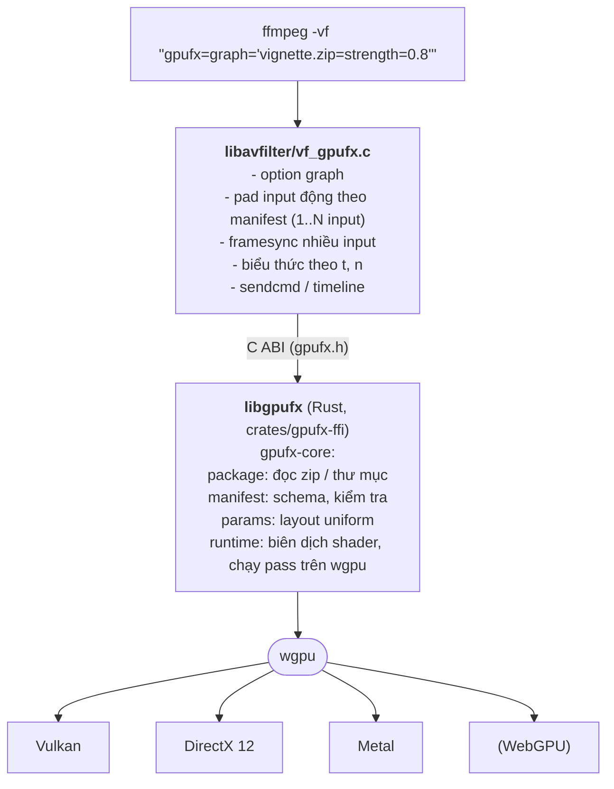

English: [DESIGN.md](DESIGN.md)

# Thiết kế: FFmpegGpuFilter (gpufx)

> Mục tiêu: chạy hiệu ứng video bằng **shader trên GPU** trong `filter_graph` của FFmpeg,
> với hiệu ứng được **nạp từ gói `.zip` bên ngoài** (kiểu CapCut). Thêm hiệu ứng mới không
> cần build lại FFmpeg: chỉ cần đưa gói zip, tham số, và nối input/output trong graph.

## 1. Yêu cầu

| # | Yêu cầu | Cách đáp ứng |
|---|---------|--------------|
| R1 | **Shader là ưu tiên số 1** (lý do dùng GPU) | Mỗi hiệu ứng *là* một chuỗi compute shader. Hỗ trợ WGSL và GLSL ngay từ bản đầu, kiểm tra lỗi shader có số dòng, nhiều pass, texture đi kèm, tham số tự sinh thành `uniform` |
| R2 | Đa hệ điều hành | Windows, Linux, macOS (Android/iOS về sau) |
| R3 | Đa phần cứng / API | Vulkan, DirectX 12, Metal qua **wgpu**; CUDA/D3D11/VAAPI qua interop (giai đoạn 2). Đã bỏ OpenGL: không dùng chung frame với FFmpeg được và không có texture storage R8/R16 cho các plane YUV |
| R4 | Hiệu ứng nạp ngoài, không build lại FFmpeg | Một filter duy nhất `gpufx` build **một lần**; hiệu ứng là gói zip |
| R5 | Dùng Rust hoặc C/C++ | Engine viết bằng **Rust**; phần nối vào FFmpeg là một file C nhỏ |

## 2. Tổng quan kiến trúc



**Vì sao chỉ một filter?** FFmpeg không có cơ chế plugin filter lúc chạy: mọi filter phải
được biên dịch vào `libavfilter`. Vì vậy ta thêm *một* filter chung `gpufx` (patch một lần,
xem `ffmpeg/integrate.sh`), còn toàn bộ logic hiệu ứng nằm trong shader của gói zip. Đây
chính là mô hình CapCut: app cố định, hiệu ứng là dữ liệu tải về.

**Vì sao Rust + wgpu?**
- wgpu là lớp trừu tượng GPU đã chín, chạy Vulkan/DX12/Metal/GL từ cùng một mã nguồn.
- Đi kèm **naga**: trình biên dịch shader thuần Rust, đọc WGSL, GLSL, SPIR-V và dịch sang
  SPIR-V/HLSL/MSL/GLSL cho từng backend. Đây là phần quan trọng nhất cho R1: tác giả viết
  shader **một lần**, chạy trên mọi API.
- Rust an toàn bộ nhớ khi đọc gói zip không tin cậy; xuất C ABI ổn định cho FFmpeg.

Phương án đã cân nhắc và loại:

| Phương án | Lý do không chọn làm lõi |
|-----------|---------------------------|
| Vulkan + SPIR-V trực tiếp (như `libplacebo`) | Không chạy native trên macOS/DX; phải tự viết lại phần wgpu đã có |
| Viết riêng CUDA/DX/Vulkan cho từng hiệu ứng | Trái R4: mỗi hiệu ứng × mỗi API |
| OpenCL (`vf_program_opencl`) | Driver kém đồng đều, không có trên macOS mới, không phải shader đồ hoạ |
| Gắn vào `libplacebo` custom shader | Chỉ Vulkan, cú pháp mpv hook, không hỗ trợ nhiều input |

## 3. Gói hiệu ứng (`.zip`)

```
vignette.zip
├── manifest.json        bắt buộc
├── shaders/*.wgsl|*.comp|*.glsl
└── textures/*.png       tuỳ chọn (LUT, mask, overlay)
```

Chi tiết định dạng và cách viết shader: [EFFECT_FORMAT-vi.md](EFFECT_FORMAT-vi.md).

Tóm tắt `manifest.json`:

```json
{
  "api": 1,
  "id": "io.github.tqk2811.gaussian-blur",
  "name": "Gaussian Blur",
  "inputs": [{ "name": "src" }],
  "params": [{ "name": "radius", "type": "float", "default": 6, "min": 0, "max": 48 }],
  "passes": [
    { "shader": "shaders/blur_h.wgsl", "inputs": ["src"], "output": "tmp" },
    { "shader": "shaders/blur_v.wgsl", "inputs": ["tmp"], "output": "out" }
  ]
}
```

- `inputs` quyết định số pad input của filter (transition dùng 2 input, v.v.). Input cuối có thể mang `repeat`
  (api 2, chỉ WGSL, `{default, min, max <= 16}`): nó mở thành các pad `<name>0..N-1`, N = số nhãn mà node graph đọc
  (`default` nếu không có nhãn); prelude thêm `gpufx_input_count/size/load`.
- `output.size` (api 2): `first` (mặc định, kích thước input đầu), `hstack` (rộng = tổng các chiều rộng, mọi input cùng
  chiều cao) hoặc `vstack` (cao = tổng, cùng chiều rộng). Kiểm ở configure và khi đổi size; kết quả phải vừa
  `max_texture_dimension_2d` của GPU. Các node graph phía sau thấy size đã lan truyền.
- `params` được runtime **tự sinh** thành struct `params` trong shader, đúng quy tắc căn lề
  uniform của WGSL/std140; tác giả chỉ việc dùng `params.radius`.
- `passes` chạy tuần tự; output của pass trước là texture đọc được ở pass sau; pass cuối là
  đầu ra.

## 4. Mô hình shader (trọng tâm)

Mỗi pass là một **compute shader**. Trước mã của tác giả, runtime chèn một *prelude* sinh tự
động (giống cách Shadertoy cung cấp `iResolution`, `iTime`):

| Binding | Tên trong shader | Ý nghĩa |
|---------|------------------|---------|
| 0 | `globals.size`, `globals.time`, `globals.frame`, `globals.time_int`, `globals.time_frac`, `globals.pixel_aspect` | Kích thước output (px), thời gian (giây, f32), số frame, thời gian chính xác (giây nguyên + phần lẻ), tỉ lệ cạnh của pixel (SAR) |
| 1 | `params.<tên>` | Tham số từ manifest |
| 2 | `out_tex` | Texture ghi kết quả (`rgba8unorm`, hoặc `rgba16float` khi chuỗi có frame trên 8 bit) |
| 3 | `smp` | Sampler tuyến tính, clamp, tuyến tính giữa các mức mip |
| 4.. | tên input/texture/pass | Texture đọc (`texture_2d<f32>`; `texture_2d_array<f32>` cho texture của gói có `layers`/`grid`) |

Sampler `smp` lọc tuyến tính cả giữa các mức mip. Texture của gói (api 2) có thể là texture mảng
(`layers`, hoặc atlas cắt theo `grid`), có chuỗi mip sinh trên CPU và alpha premultiplied, làm một lần
khi nạp `Program`; kích thước ảnh được kiểm từ header PNG (4096 mỗi cạnh, 64 M texel mỗi gói, giới hạn
của device) trước khi giải mã. Input khai `mipmaps` được sinh chuỗi mip trên GPU mỗi frame ngay trong
texture của nó (slot input, hoặc texture trong pool của hiệu ứng ghi ra nó; texture có mip và không có
mip nằm ở hai pool riêng), không copy. Tham số `expr` được biên dịch vào shader thành
`gpufx_expr_<name>`, sinh từ cây đã parse; hiệu ứng có biểu thức khác mặc định tự dựng pipeline riêng khi
biểu thức đổi (`Program` giữ pipeline mặc định). Xem [EFFECT_FORMAT-vi.md](EFFECT_FORMAT-vi.md).

Kèm hàm tiện ích `gpufx_in_bounds(id)`, `gpufx_uv(id)`, `gpufx_write(id, color)`.

Vì sao compute thay vì fragment shader: không cần render pass/vertex buffer, dễ làm nhiều
pass, đọc/ghi tự do (blur tách trục, histogram, reduce) và ánh xạ thẳng sang CUDA/Metal
compute khi cần.

Ngôn ngữ shader:

| Ngôn ngữ | Trạng thái | Ghi chú |
|----------|-----------|---------|
| WGSL | ✅ prototype | Ngôn ngữ chuẩn của WebGPU, lỗi rõ ràng nhất |
| GLSL 450 (compute) | ✅ prototype | Thuận tiện để port shader có sẵn (GL Transitions, Shadertoy) |
| SPIR-V (biên dịch sẵn) | Kế hoạch | Cho tác giả dùng HLSL/Slang → SPIR-V bằng công cụ ngoài |
| HLSL / Slang | Kế hoạch | Biên dịch trong `gpufx pack` sang SPIR-V/WGSL |
| Fragment shader kiểu Shadertoy (`mainImage`) | Kế hoạch | Bọc tự động thành compute |

Kiểm tra shader trước khi chạy: naga phân tích và validate, lỗi trả về kèm tên file và vị
trí trong mã (thử: `gpufx check <gói>`). Filter FFmpeg in lỗi đó qua `av_log` và từ chối khởi
tạo graph thay vì chạy sai.

## 5. Filter FFmpeg `gpufx`

Tham chiếu đầy đủ (cú pháp, option, lệnh runtime, ví dụ): [design/filters/gpufx-vi.md](design/filters/gpufx-vi.md).
Các filter khác: [gpufx_upload / gpufx_download](design/filters/gpufx_transfer-vi.md),
[gpufx_ai_framerate](design/filters/gpufx_ai_framerate-vi.md), [gpufx_ai_upscale](design/filters/gpufx_ai_upscale-vi.md).

Lý do thiết kế:

- **Một option duy nhất, `graph`.** Một effect, một chuỗi (`a.zip|b.zip`) và cả graph có nhãn nhiều input và output đều là
  một chuỗi, qua cùng một đường parse (một effect là graph tuyến tính một node). Số input pad và output pad lấy từ
  graph, nên `-filter_complex` của FFmpeg nối filter này như mọi filter khác.
- **Một lần submit GPU cho mỗi sự kiện.** Mọi pass của mọi effect trong filter, với texture trung gian lấy từ pool, chạy
  trong một lần submit; giữa các effect không có frame nào rời GPU và không có gì phải chuyển đổi. Nhiều filter `gpufx`
  nối nhau cũng giữ frame trên GPU (`out_format=rgba` bỏ chuyển đổi YUV ở giữa).
- **Chỉ trả ra frame GPU**, giống các filter `*_cuda`: output là hardware frame của API của device (Vulkan, D3D12, D3D11,
  VideoToolbox), nên `hwdownload` / `gpufx_download` đứng trước filter CPU và encoder. Input CPU do chính filter upload,
  nên pipeline một filter không cần `hwupload`. Device lấy từ input GPU, không thì `-filter_hw_device`; loại device quyết
  định API. Thêm một API là thêm một dòng vào `hw_apis[]` và các nhánh trong các switch theo API của `vf_gpufx.c`.
- **Tham số là biểu thức FFmpeg**, viết inline cạnh package và tính mỗi frame (`t`, `n`, `w`, `h`...), nên keyframe và
  transition không cần tool ngoài; `sendcmd` / `zmq` đổi chúng trong khi stream chạy.
- **Tắt một effect không cấp phát gì.** `enable=` / `bypass=` inline biến effect thành bản copy của một input, nên plan,
  texture trong pool và binding giữ nguyên, bật/tắt không cấp phát. `enable=` ở mức filter có thể đưa texture input đi
  tiếp mà không copy trên GPU (`passthrough`), và `bypass=auto` phục vụ transition cần tiếp tục hiện clip nó kết thúc ở đó.
- **Framesync khi có nhiều input.** Input đầu quyết định độ dài, frame rate, SAR và (trừ khi effect xếp input bằng
  `output.size`) kích thước; input khác lặp, bỏ hoặc giữ frame để theo nó.
- **Kiểm chặt lúc configure**, báo lỗi nêu tên effect, input và key, thay vì chuyển đổi lặng lẽ.

Đường đi của frame phía sau nằm ở [mục 6](#6-đường-đi-của-frame-và-hiệu-năng). Shader nhận gì (prelude, binding, dispatch,
màu): [EFFECT_FORMAT-vi.md](EFFECT_FORMAT-vi.md#tham-chiếu-shader-shader-nhận-gì-ngoài-parameter).

## 6. Đường đi của frame và hiệu năng

**Hiện tại (P1 xong):** các plane của frame trong RAM → upload texture → pass chuyển đổi dựng sẵn →
các pass của hiệu ứng → pass chuyển đổi dựng sẵn → copy về RAM. libgpufx tự chuyển `rgba`,
`rgba64le`, `nv12`, `p010le`, `yuv420p`/`yuv422p`/`yuv444p` và bản `10le`, `yuva420p`, `yuva444p`
(và tên gọi `yuvj`):

- Mỗi plane được upload vào một texture số nguyên (`r8uint`, `rg8uint`, `r16uint`, `rg16uint`,
  `rgba16uint`: format cơ bản của WebGPU, có trên mọi backend, khác với `r16unorm` cần feature chỉ có
  trên native). Một pass compute áp ma trận (BT.601, BT.709, BT.2020 non-constant luminance) và range
  (limited/full) của `AVFrame`, nội suy chroma bilinear theo vị trí chroma (left, center, top-left,
  top, bottom-left, bottom; không rõ thì left) rồi ghi texture RGBA mà hiệu ứng đầu đọc thẳng. RGBA
  8-bit straight bỏ qua pass này.
- Ở output, một pass đổi kết quả RGBA sang format output (chroma lấy mẫu xuống bằng lọc tam giác,
  `[1 3 3 1]` khi ở giữa, `[1 2 1]` khi co-sited), đóng gói từng plane vào storage buffer, copy sang
  một buffer map được rồi đọc về.
- Texture RGBA là `rgba16float` khi chuỗi có frame (input hoặc output) trên 8 bit, nên 10-bit giữ
  được qua chuỗi; còn lại là `rgba8unorm`. PNG trong gói vẫn là `rgba8unorm`.
- Filter: input không có `formats` nhận thẳng các format này (FFmpeg đổi format khác sang một trong
  số đó); input có `formats` nhận nguyên frame. Format, ma trận (FCC, SMPTE 240M, YCgCo…) và BT.2020
  constant luminance mà libgpufx không xử lý thì vẫn đổi bằng `swscale` sang `rgba` (hoặc `rgba64le`
  khi trên 8 bit) như trước; output cũng vậy. Manifest không có `output` thì được xuất mọi format
  này (`rgba` đứng đầu), nên encoder nhận `yuv420p` không cần `scale` sau `gpufx`. Output đó có thể
  là YUV không alpha, bỏ alpha mà hiệu ứng ghi: hiệu ứng tạo ra alpha cần khai báo `output.formats`.
- Vị trí chroma không rõ thì là center với frame full range (JPEG/MJPEG), còn lại là left.
- Mỗi gói biên dịch pipeline `rgba8unorm` lúc nạp, pipeline `rgba16float` khi gặp frame trên 8 bit
  đầu tiên (frame đó chờ biên dịch; lỗi có ghi tên gói).
- `GPUFX_API_VERSION` chỉ tăng khi thêm mới: filter nhận thư viện có version không nhỏ hơn header.
- Filter bị tắt (timeline) đổi input 0 sang format output trên GPU mà không chạy hiệu ứng.

Các filter `gpufx` trong cùng process dùng chung một GPU device.

Gói đã nạp cũng được dùng chung. Mỗi gói (khoá theo đường dẫn tuyệt đối và GPU device) chỉ
được đọc và biên dịch một lần trong process: `Program` gồm manifest, pipeline, texture PNG,
sampler. Mỗi filter giữ một `Effect` riêng gồm giá trị tham số, uniform buffer và texture
frame. Khi không còn filter nào dùng gói thì `Program` được giải phóng, lần mở sau đọc lại
file. Sửa file zip khi vẫn còn filter dùng gói đó thì không có tác dụng, kể cả với filter
mở gói sau khi sửa.

Chi phí chính là upload/readback và chuyển màu trên CPU. Lộ trình bỏ dần:

| Giai đoạn | Thay đổi | Lợi ích |
|-----------|----------|---------|
| P1 (xong) | Chuyển YUV (NV12/P010/yuv420p…) ↔ RGBA trên GPU trong runtime; texture `rgba16float` khi có frame trên 8 bit | Bỏ `swscale`, hỗ trợ 10-bit/HDR |
| P2 | Pipeline hoá: double buffer readback, không chặn chờ frame trước | Tăng throughput 2–3× trên GPU rời |
| P3 (xong) | **Zero-copy** với `AV_PIX_FMT_VULKAN`: wgpu device tạo từ `AVVulkanDeviceContext` (`wgpu-hal` `device_from_raw`), đọc và ghi thẳng các `VkImage` của `AVVkFrame` (xem "Frame Vulkan" dưới đây) | Không qua RAM khi decode/encode bằng Vulkan |
| P4 | Interop **CUDA** (NVDEC/NVENC): `hwmap` CUDA → Vulkan (external memory) hoặc `VK_KHR_external_memory` trực tiếp | Dùng được với `-hwaccel cuda` |
| P5 (xong, chưa chạy trên phần cứng) | Frame **D3D12** tại chỗ trên `ID3D12Device` của FFmpeg; **D3D11** qua shared NT handle sang DX12 của wgpu (xem "Frame D3D12 và D3D11" bên dưới) | Dùng được với `hwupload` trên d3d12va/d3d11va; frame decoder tốn một lần copy GPU |
| P6 (xong VideoToolbox, chưa chạy trên máy Mac) | VideoToolbox (`CVPixelBuffer` → IOSurface → `MTLTexture`, xem "Frame VideoToolbox" bên dưới); VAAPI/DRM-PRIME (Linux) | Phủ hết hwaccel phổ biến |

Ở mọi giai đoạn, **định dạng gói và shader không đổi**: tác giả không cần biết frame đến từ
CPU hay CUDA.

### Đồ thị GPU trong một filter (xong)

Một `gpufx` chạy cả đồ thị hiệu ứng, nên nhánh phức tạp ở lại trên GPU với mọi backend
(Vulkan, D3D12, Metal), không cần hw frame:

```sh
ffmpeg -i a.mp4 -i b.mp4 -filter_complex "[0:v][1:v]gpufx=graph='[0]split[a][b]; [a]gaussian-blur.zip[ba]; [b]grayscale.zip|vignette.zip[gb]; [ba][gb]crossfade.zip[x]; [x][1]wipe-transition.zip[out]'[v]" -map "[v]" out.mp4
```

Dấu nháy đơn che `;` và `[]` khỏi filter graph bên ngoài. Quy tắc:

- Các câu cách nhau bởi `;`; mỗi câu đọc nhãn, chạy một nút rồi ghi nhãn.
- `[0]`, `[1]`... là input pad của filter (tên `in0`, `in1`...). Mọi pad tới pad cao nhất đều phải được đọc.
- Có thể bỏ nhãn, như filtergraph của FFmpeg, nhưng ở mỗi phía của câu lệnh thì bỏ hết hoặc ghi đủ. Input không nhãn
  gắn vào các input pad thấp nhất mà không nhãn nào ở bất kỳ đâu trong graph chỉ tới, kể cả các câu phía sau
  (`[1]a.zip[x]; b.zip[y]` cho `b.zip` pad `[0]`). Khác với `ffmpeg -filter_complex`, vốn gắn stream chưa dùng đầu
  tiên theo thứ tự mà không nhìn trước; gpufx nhìn trước vì mỗi pad chỉ được đọc một lần. Output không nhãn thành
  output của graph tên `out0`, `out1`..., bỏ qua nhãn graph đã dùng; `split` không nhãn ghi hai output.
- Chỉ mô tả gồm một câu lệnh hoàn toàn không nhãn mà nút là chain package (không phải `split`/`null`) mới chạy như
  chain cũ: pad đặt theo input của manifest đầu, output `default`. Thêm bất kỳ nhãn nào thì tên pad thành `in0`,
  `in1`... và output `out0`. `null` đứng một mình là graph hợp lệ, không làm gì.
- Nhãn khác (chữ, số, `_`, `-`; không có `.` vì trùng với `nhãn.tham_số`) được ghi đúng một lần và đọc nhiều nhất một lần (muốn đọc hai lần thì `split`).
- **Output**: các nhãn không câu nào đọc là output pad của filter, theo thứ tự được ghi (được phép
  nhiều output; tên pad là nhãn). Không có danh sách output riêng: nhãn gõ sai thành output pad thừa,
  FFmpeg báo là chưa nối.
- Nút là `split` (một nhãn vào, bao nhiêu nhãn ra cũng được), `null` (một vào, một ra), hoặc các gói
  nối bằng `|` như `graph=`, đọc số nhãn bằng số input của gói đầu và ghi một nhãn. `split` và
  `null` không tốn gì: output của chúng *chính là* input (hai cạnh cùng đọc một texture).
- Hiệu ứng ghi kích thước input đầu của nó (size xếp chồng với `output.size` `hstack`/`vstack`, lan truyền tới các node phía sau); output pad k lấy SAR và frame rate của input
  pad mà nguồn của nó đi ra. Frame ra theo sự kiện của input 0 (framesync như khi có nhiều input).
- Mỗi input pad upload một lần, mỗi output pad readback một lần, mọi output qua một buffer readback
  dùng chung; cả đồ thị chạy trong một lần submit, hiệu ứng theo thứ tự topo. Các frame output của
  một sự kiện được gửi cùng nhau.
- `graph='a.zip|b.zip'` là đồ thị thẳng: `EffectGraph::parse` dựng nó, và một hiệu ứng đơn cũng chạy
  qua cùng đoạn mã. `graph` là option duy nhất của filter.
- Tham số viết inline sau từng gói của một nút (`[b]grayscale.zip|vignette.zip=strength=0.6[gb]`, xem "Tham số
  inline" trong [design/filters/gpufx-vi.md](design/filters/gpufx-vi.md)), nên ví dụ graph có giá trị là
  `graph='[0]split[a][b]; [a]gaussian-blur.zip=radius=8[ba]; [b]grayscale.zip|vignette.zip=strength=0.6[gb]; [ba][gb]crossfade.zip=progress=clip((t-1)/1.5\,0\,1)&enable=between(t\,1\,3)&bypass=auto[x]'`.
  `sendcmd` gọi giá trị lúc chạy bằng `nút.tên=value` trên mọi gói của đồ thị theo thứ tự câu (label gói, chỉ số
  từ 0, tên trơn, hoặc nhãn output của nút: `ba.radius`; `gb.strength` tìm hiệu ứng duy nhất trong
  `grayscale|vignette` có `strength`).
- Kiểm lúc tạo filter: vòng lặp, nhãn đọc mà chưa ghi, ghi hai lần hoặc đọc hai lần, input pad không
  được đọc, số nhãn so với số input của nút, nhãn output là số. Kiểm lúc configure: quy tắc kích
  thước và format trong manifest của mọi nút (một cạnh mang kích thước của hiệu ứng ghi nó và format
  negotiate giữa hai hiệu ứng), và input pad được các hiệu ứng không có format chung đọc.
- Với `enable=`, đồ thị bị tắt gửi input pad nguồn của mỗi output (hoặc pad do `bypass` chọn),
  chuyển sang format của output.
- Đường dẫn trong đồ thị không được chứa `[`, `]`, `;` hoặc `|`.

C API (v5, chỉ thêm): `gpufx_effect_open_graph` (hàm open duy nhất), `gpufx_effect_output_count`, `gpufx_effect_output_name`,
`gpufx_effect_output_source`, `gpufx_effect_output_pad_format[_count]`, `gpufx_effect_process_graph`,
`gpufx_effect_convert_graph`, `gpufx_effect_output_size(fx, output, streams, count, &w, &h)` (size của một output
theo size các input; `config_output` của `vf_gpufx` đặt size outlink từ nó); xem `gpufx.h`.
Tham số inline: `gpufx_effect_open_graph` nhận chúng ở mọi nút, còn `gpufx_effect_option_count` /
`gpufx_effect_option` đọc lại chúng (hằng số đã được áp; biểu thức, `enable` và `bypass` do bên gọi tự tính).

### Frame Vulkan (xong)

```sh
ffmpeg -init_hw_device vulkan=vk:0,disable_multiplane=1 -filter_hw_device vk -i a.mp4 \
  -vf "format=nv12,hwupload,gpufx=graph=vignette.zip,gpufx=graph=sepia.zip,hwdownload,format=nv12" out.mp4
```

- Mọi pad input nhận thêm `AV_PIX_FMT_VULKAN`, pad output chỉ nhận format GPU ([mục 5](#5-filter-ffmpeg-gpufx)). Input có thể trộn frame
  Vulkan và frame CPU (filter tự upload frame CPU lên cùng device).
  sw_format của từng input Vulkan phải là format libgpufx chuyển được (`nv12`, `p010le`, `yuv420p`, `rgba`…) và
  được kiểm theo quy tắc của manifest như format phần mềm. Filter có cờ `FF_FILTER_FLAG_HWFRAME_AWARE`.
- **Một device.** `init` mở gói trên device noop của wgpu (pad và format phải biết trước khi negotiate, chưa
  tạo device GPU nào); filter không bao giờ tạo device riêng (`gpufx_effect_use_default_device` vẫn còn trong
  C API cho nơi gọi khác); khi các link được
  configure, `gpufx_effect_use_vulkan` chuyển effect sang device của FFmpeg: libgpufx bọc các handle của
  `AVVulkanDeviceContext` bằng `wgpu-hal` (`Instance::from_raw`, `expose_adapter`, `Adapter::device_from_raw`,
  rồi `create_device_from_hal`), biên dịch lại gói cho device đó (dùng chung theo `VkDevice` như mọi device) và
  chép giá trị tham số. Không thứ gì của FFmpeg bị huỷ theo (drop callback rỗng); filter giữ tham chiếu tới
  device cho tới khi effect được giải phóng.
- **wgpu chỉ dùng những gì device đã bật.** wgpu-hal chọn tính năng (và bỏ kiểm tra biên của chính nó khi có
  `robustBufferAccess`) theo những gì *physical device* hỗ trợ, nhưng FFmpeg chỉ bật một phần. Vì vậy wgpu
  nhìn device qua một `vkGetInstanceProcAddr` bọc lại: `vkEnumerateDeviceExtensionProperties` chỉ liệt kê
  extension đã bật trên device, `vkGetPhysicalDeviceFeatures[2]` AND feature lõi với feature đã bật và mỗi
  struct feature của extension với struct cùng loại trong chuỗi tạo device của FFmpeg (struct đã nâng lên lõi, như timeline
  semaphore, lấy trường từ `VkPhysicalDeviceVulkan11/12/13Features` của FFmpeg). Queue tạo với cờ
  (`VK_KHR_internally_synchronized_queues`) được lấy bằng `vkGetDeviceQueue2`.
- **Queue.** Họ queue đầu tiên có cả graphics lẫn compute, queue 0 (wgpu ghi render pass và barrier đồ hoạ: trên họ
  chỉ có compute mà NVIDIA liệt kê trước thì device bị lost; libgpufx từ chối họ như vậy). Filter giữ `lock_queue` của FFmpeg quanh mỗi lần gọi, nên
  lệnh submit của FFmpeg (hwupload, filter Vulkan khác) không tranh với wgpu.
- **Frame.** Mỗi plane một `VkImage`, theo format từng plane của FFmpeg (`R8`, `R8G8`, `R8G8B8A8`, `R16`,
  `R16G16`, `R16G16B16A16` `_UNORM`): input cần device có `disable_multiplane=1` (hoặc frame tạo theo cách đó);
  frames context output do gpufx tạo dùng `AV_VK_FRAME_FLAG_DISABLE_MULTIPLANE` và cần usage `STORAGE`.
  Image multiplane bị từ chối lúc configure kèm thông báo, frame input không có usage `SAMPLED` cũng vậy. FFmpeg 9.0 mặc định tạo
  frames context `yuva420p`/`yuva444p` không có usage nào (của `hwupload` thì dùng được), nên output chuyển sang
  format khác, ví dụ `rgba`. sw_format của output là của input nguồn nếu effect
  được phép xuất, không thì format đầu tiên của pad output mà libgpufx chuyển được và ghi được.
  `out_format` thay cho cách chọn đó (đúng format ấy, hoặc lỗi lúc configure). Chuỗi nhiều filter rời giữ
  RGBA ở giữa bằng `out_format=rgba` trên mọi filter trừ cái cuối (số đo ở [BENCHMARK-vi.md](BENCHMARK-vi.md)).
- **Mỗi frame**, CPU không chờ: filter khoá mỗi `AVVkFrame` một lần (`lock_frame`; một frame `split` phía
  trước có thể nằm trên hai pad), libgpufx bọc mỗi image thành texture wgpu (`texture_from_raw`, bộ nhớ
  ngoài, callback drop rỗng) hoặc dùng lại wrapper đã tạo ở frame trước (LRU 16 frame mỗi pad, khoá theo
  image, semaphore, format, kích thước; bind group dựng từ chúng cũng cache như vậy, nên pool frame quay
  vòng chỉ bind một lần). Giữa các lần gọi wgpu thấy mọi wrapper ở `GENERAL`; image bị để ở layout khác
  (bởi `hwupload`, `hwdownload`, filter khác) được chuyển sang `GENERAL` bằng barrier thô trong command
  buffer submit trước (output thì từ `UNDEFINED`). Filter giữ frames context của input và output tới khi
  effect bị giải phóng, nên image không bị giải phóng trước wrapper. Rồi libgpufx ghi pass chuyển đổi input
  (plane đọc như texture unorm), các hiệu ứng và pass chuyển đổi output (plane ghi như storage texture),
  chuyển mọi image về `GENERAL`, rồi submit một lần, chờ timeline semaphore của mọi image ở `sem_value` và
  signal `sem_value + 1` (`add_wait_semaphore`/`add_signal_semaphore`, mỗi semaphore một lần). Sau đó filter
  ghi `layout`, `sem_value`, `access` vào `AVVkFrame` rồi mở khoá.
- **VRAM:** không texture upload, không storage buffer output, không buffer readback; texture pass trong pool
  giống hệt đường phần mềm; mỗi input giữ một texture RGBA đã chuyển (như khi upload), còn output chính là
  frame trong pool của FFmpeg. Input `rgba` thẳng của graph không deep, không hiệu ứng nào đọc mip chain của
  nó, thì không cần cả hai: hiệu ứng sample thẳng image (không pass copy-in), và các hiệu ứng đọc nó được bind
  lại vào image mới mỗi frame. Tương tự, output `rgba` thẳng (`out_format=rgba`) của graph như vậy do pass cuối
  của hiệu ứng tạo ra nó ghi thẳng, không texture trong pool và không pass copy-out, khi không gì khác đọc
  output của hiệu ứng đó (hiệu ứng khác hay output khác của graph, mip chain, pass khác của chính hiệu ứng).
  Mọi trường hợp khác, và frame bị bypass, vẫn đi đường copy.
- **Pass chuyển đổi của frame GPU** (Vulkan và D3D12): pass vào của frame YUV chuyển 16x16 pixel mỗi
  workgroup, các mẫu chroma mà chúng đọc được nạp một lần vào bộ nhớ workgroup (thay vì bốn lần load có
  clamp mỗi pixel). Output YUV được ghi bằng một pass cho mọi plane: mỗi invocation ghi một mẫu chroma và
  các mẫu luma (và alpha) của khối của nó, từ một tile pixel đã đổi sang YUV một lần, trọng số bộ lọc
  chroma tính theo hàng và cột. Pass ghi plane RGBA chọn kênh bằng `select`, không dùng chỉ số vector chỉ
  biết lúc chạy (NVIDIA đẩy sang local memory). Byte ra giống hệt trước (test so với đường CPU). Đo với
  một vignette trên texture wgpu 1080p (RTX 4060 Laptop, 3000 frame): nv12 copy-in 0.108 → 0.087 ms,
  copy-out 0.130 → 0.105 ms; rgba copy-out 0.087 → 0.049 ms. Không gộp chuyển đổi vào pass đầu/cuối của
  hiệu ứng: hiệu ứng lấy mẫu input qua sampler tuyến tính (lọc trên plane YUV không ra cùng RGB như bản
  copy) và mỗi pass hiệu ứng sẽ cần một pipeline cho mỗi format frame.
- **Đo thời gian:** `GPUFX_PROFILE=1` xin device timestamp query và khi giải phóng mỗi graph thì in thời gian GPU
  mỗi frame của copy-in, hiệu ứng, copy-out, cùng thời gian CPU mỗi frame (prepare, bind, record, import,
  submit). Nó tách frame thành ba compute pass và chờ frame trễ bốn frame, nên khi bật thì thời gian chạy
  tổng không còn đúng.
- Filter bị tắt (timeline) luôn chuyển frame trên GPU sang frames context của output (không đưa tham chiếu
  vì output có frames context riêng). Input chưa bắt đầu hiện frame đen upload một lần (đục với format có
  alpha); input CPU cũng vậy, ở format upload của nó.
- Rust: `GpuFrame` (texture từng plane trên device của effect) và `EffectGraph::encode_gpu`, ghi cả đồ thị vào
  command encoder của người gọi mà không submit (không phụ thuộc backend, nền cho bước D3D12);
  `GpuContext::from_vulkan` và `EffectGraph::process_vulkan` (`gpufx_core::vulkan`, Linux và Windows) thêm phần
  dùng chung và đồng bộ Vulkan. C API (v6, chỉ thêm): `gpufx_vulkan_supported`, `gpufx_effect_use_vulkan`,
  `gpufx_effect_process_vulkan`; xem `gpufx.h`.
- Build: `scripts/build-prebuilt.sh` configure libavfilter với `--enable-vulkan` khi `libavutil` build sẵn có
  Vulkan và tìm được Vulkan-Headers của Khronos (clone tag `v1.4.321`; FFmpeg cần header mới hơn bản của Ubuntu
  noble), và giữ `hwupload`, `hwdownload`, `hwmap`. Không thì gpufx được build không có frame Vulkan và test bỏ
  qua phần đó.
- **Decoder:** decoder Vulkan (`-hwaccel vulkan`) xuất image multiplane nên frame của nó hiện bị từ chối (cần
  `hwdownload,hwupload` hoặc copy trên GPU sang image từng plane; xem Backlog).
- **Submit** trên một device dùng chung được tuần tự hoá bằng mutex trong libgpufx, giữ từ lúc đặt semaphore
  tới `queue.submit` (ngoài `lock_queue` của FFmpeg), trong một error scope của wgpu; submit bị wgpu từ chối
  được lấy lại semaphore và làm các frame Vulkan sau trên device đó báo lỗi rõ ràng.
- Đã chạy trên lavapipe: test bundle so framemd5 của `hwupload,gpufx,…,hwdownload` với frame CPU do gpufx tự upload (rgba,
  nv12, yuv420p, yuv444p, p010le, yuv420p10le, rgba64le, đồ thị có hai input là cùng một frame split, hai filter
  liền nhau, đổi format output): giống hệt. Test Rust so `encode_gpu` với đường CPU từng byte.

### Filter truyền frame `gpufx_upload` / `gpufx_download` (Vulkan)

Cách dùng và option: [design/filters/gpufx_transfer-vi.md](design/filters/gpufx_transfer-vi.md).

Thay thẳng cho `hwupload` / `hwdownload` trên device Vulkan (`ffmpeg/vf_gpufx_transfer.c`, C thuần dùng
helper Vulkan nội bộ của FFmpeg `libavutil/vulkan.h`, không cần libgpufx). Lý do: trên NVIDIA, FFmpeg 9.0
copy qua staging buffer (tắt host image copy và import bộ nhớ host), và `hwdownload` chờ trên CPU từng lần
copy (`ff_vk_exec_wait`), nên CPU và GPU chạy lần lượt. Trên driver Intel Windows, host image copy của
FFmpeg 9 bị lỗi; các frames context do gpufx tạo bỏ cờ usage host-transfer, và `gpufx` từ chối frame của
`hwupload` trên driver đó ([INTEL_VULKAN-vi.md](INTEL_VULKAN-vi.md)).

- **gpufx_upload** (`depth`, mặc định 3): frames context tạo trên `-filter_hw_device` như `hwupload` (format
  vào: sw format của device mà plane khớp 1:1 với plane Vulkan). Vòng `depth` staging buffer map sẵn,
  host-coherent, mỗi execution context một cái: memcpy vào slot, barrier + `vkCmdCopyBufferToImage` từng
  plane, submit không chờ. CPU chỉ chờ khi quay lại slot mà lần copy trước chưa xong (`ff_vk_exec_start`
  chờ fence của slot đó).
- **gpufx_download** (`latency`, mặc định 2): filter `activate`. Frame k được submit (`vkCmdCopyImageToBuffer`
  vào slot k mod (latency+1), bộ nhớ host-cached), frame k-latency được chờ (thường đã xong), invalidate,
  chép vào buffer của `ff_get_video_buffer` rồi gửi đi kèm props. Gặp EOF thì xả hết frame đang bay rồi mới
  chuyển status. Format ra phải là sw_format của frame (thêm `format=<sw_format>` phía sau, như `hwdownload`).
  Input thưa (nguồn live) thì mỗi frame ra trễ `latency` frame; `latency=0` tắt pipelining. Cả hai filter
  không nhận đổi kích thước frame giữa chừng (`hwupload`/`hwdownload` thì nhận): graph dừng với EINVAL.
- **Đồng bộ**: `ff_vk_exec_add_dep_frame` (lock_frame, chờ timeline semaphore của từng image ở `sem_value`,
  signal `sem_value + 1`), `ff_vk_frame_barrier` không chuyển queue family, và `ff_vk_exec_submit` (giữ
  `lock_queue` của FFmpeg), trên họ queue graphics của FFmpeg, cùng họ mà `gpufx` và wgpu dùng. Vì vậy trộn
  được với `hwupload`, `hwdownload`, `gpufx` và các filter `*_vulkan`. Execution giữ tham chiếu frame tới khi
  đọc xong bản copy.
- **Plane**: image multiplane (aspect `PLANE_n`) và mỗi plane một image (`disable_multiplane=1`) đều chạy.
  Mỗi plane có vùng riêng trong staging buffer: hàng căn theo `optimalBufferCopyRowPitchAlignment` (và là
  bội của cỡ texel, vì `bufferRowLength` tính bằng texel), offset plane căn theo
  `optimalBufferCopyOffsetAlignment` (ít nhất 16). Kích thước copy là kích thước link (frames context của
  decoder có thể lớn hơn).
- **Queue**: `ff_vk_exec_pool_init` lấy queue với cờ mà libavfilter được biên dịch; libavutil prebuilt tạo
  queue với `VK_KHR_internally_synchronized_queues`, header Vulkan của bản build không biết cờ này, nên
  `vkGetDeviceQueue2` không trả queue nào. Filter lấy lại queue với `queue_flags` của device (validation layer
  vẫn báo một lần cho lần gọi đầu của pool, VUID-06225).
- Build: `integrate.sh` thêm `vf_gpufx_transfer.o vulkan.o` (bản `libavutil/vulkan.c` của libavfilter) và
  `gpufx_upload/download_filter_deps="vulkan"`; `docker/keep-filters.txt` (`FFMPEG_FILTERS=keep`) giữ cả hai.
- Test (`scripts/test-bundle.sh`): vòng nv12, yuv420p, rgba khớp từng bit, multiplane lẫn
  `disable_multiplane=1`, trộn với `hwupload` / `hwdownload`; `gpufx` ở giữa khớp đường phần mềm; `latency=4`
  vẫn ra đủ frame. Kiểm tay thêm: p010, validation layer (bản copy không sinh VUID nào; `hwupload`/`hwdownload`
  gốc sinh VUID-00174/00191).

Số đo trên clip 90 s (RTX 4060 Laptop, GPU rảnh): xem [BENCHMARK-vi.md](BENCHMARK-vi.md).

### Frame D3D12 và D3D11 (đã build và cross-compile, chỉ job CI Windows chạy thử)

```sh
ffmpeg -init_hw_device d3d12va=dx -filter_hw_device dx -i a.mp4 \
  -vf "format=nv12,hwupload,gpufx=graph=vignette.zip,hwdownload,format=nv12" out.mp4
ffmpeg -init_hw_device d3d11va=dx -filter_hw_device dx -i a.mp4 \
  -vf "format=nv12,hwupload,gpufx=graph=vignette.zip,hwdownload,format=nv12" out.mp4
```

- Pad nhận thêm `AV_PIX_FMT_D3D12` và `AV_PIX_FMT_D3D11` (khi libavfilter build có d3d12va/d3d11va và libgpufx
  là bản Windows). Quy tắc như Vulkan: mọi input/output là frame của cùng một API, hoặc không cái nào.
  sw_format: thực tế là `nv12` và `p010le` (d3d12va của FFmpeg chỉ làm hai format này, và của d3d11va gpufx chỉ
  đọc hai format này); libgpufx cũng nhận resource RGBA8/RGBA16 (`rgba`, `rgba64le`) từ chương trình khác. Format
  khác bị từ chối lúc configure (BGRA của d3d11va cần đảo kênh: backlog). Texture có hơn một mip level bị từ chối.
- **Không có alpha.** Không sw_format nào trong số này có alpha, nên output có alpha của effect mất alpha ở
  `hwdownload`, còn `out_format` có alpha thì lỗi lúc FFmpeg tạo frame. Package `alpha-extract` đưa alpha thành ảnh
  xám `nv12` qua một output của graph; `alphamerge` ghép lại trên CPU.
- **D3D12, một device.** wgpu-hal 30 không có `device_from_raw` cho DX12, nhưng device D3D12 là singleton theo
  adapter trong một process: libgpufx mở adapter DX12 của wgpu có LUID trùng với device
  (`ID3D12Device::GetAdapterLuid`) rồi kiểm tra wgpu nhận đúng `ID3D12Device` đó (so COM identity); nếu không
  (runtime D3D12 khác như Agility SDK, adapter wgpu bỏ qua như bản "Microsoft Basic Render Driver" trùng WARP
  khi chạy headless) thì từ chối kèm thông báo. wgpu có command queue riêng trên device đó.
- **Frame D3D12 tại chỗ.** `AVD3D12VAFrame.texture` được bọc một lần cho mỗi plane (`texture_from_raw` +
  `with_plane_slice`: view R8/RG8 hoặc R16/RG16 của resource NV12/P010). Frame nằm ở
  `D3D12_RESOURCE_STATE_COMMON` (quy ước của FFmpeg); libgpufx tự ghi barrier sang state cần dùng và quay lại,
  theo từng subresource của slice, trong command list riêng trước và sau của wgpu, và tạo wrapper ở sẵn state
  đó nên wgpu không ghi barrier nào (wgpu sẽ chuyển cả resource một lần cho mỗi wrapper plane). Một lần submit
  chờ `sync_ctx.fence` của mỗi frame tại `fence_value` và signal `fence_value + 1` (mỗi fence một lần); filter
  lưu lại giá trị. Upload D3D12 của FFmpeg không chờ fence của frame trước khi ghi, nên mỗi lần gọi trước hết
  chờ trên CPU lần submit trước (một event đang chạy).
- **Một lần copy trên GPU khi không dùng tại chỗ được**, vào texture libgpufx giữ theo pad và plane (VRAM: một
  frame cho mỗi pad như vậy): input là một slice của texture array (`AV_D3D12VA_FRAME_FLAG_TEXTURE_ARRAY`,
  decoder), lớn hơn frame hoặc cấm shader đọc, và output không có `D3D12_RESOURCE_FLAG_ALLOW_UNORDERED_ACCESS`.
  Frames context output do gpufx tạo xin unordered access trước, không được thì dùng frame ghi bằng copy
  (có thông báo verbose); mỗi frames context thử được kiểm bằng một lần `av_hwframe_get_buffer`, vì device có thể
  nhận context nhưng không tạo được texture.
- **D3D11.** wgpu không có backend D3D11: hiệu ứng chạy trên device D3D12 của wgpu cùng adapter với device
  D3D11 (LUID qua `IDXGIDevice`). Texture có `D3D11_RESOURCE_MISC_SHARED_NTHANDLE` được mở sang đó bằng
  `CreateSharedHandle`/`OpenSharedHandle`, không copy (giữ mở tối đa 64 cái, có giữ tham chiếu tới texture).
  Frames context output gpufx tạo là loại texture này (`SHARED | SHARED_NTHANDLE`, bind
  `SHADER_RESOURCE | UNORDERED_ACCESS`, bỏ UAV nếu device không cho: khi đó dùng copy D3D12 ở trên), nên output
  không bị copy. Input từ `hwupload` hay decoder không share được nên được copy một lần trên immediate context
  D3D11 (`CopySubresourceRegion`, đồng thời tách slice của array) vào texture share libgpufx giữ cho mỗi pad
  input (VRAM: một frame cho mỗi pad input). Không dùng D3D11On12: nó bọc resource D3D12 cho D3D11, còn ở đây
  frame do device D3D11 của FFmpeg tạo; keyed mutex cũng được nhưng cần texture `SHARED_KEYEDMUTEX` và
  acquire/release phía CPU. Thứ tự: một fence D3D12 share với device D3D11 (`ID3D11Device5::OpenSharedFence`,
  D3D11.4): immediate context signal `v` rồi flush, lần submit D3D12 chờ `v` và signal `v + 1`, immediate context
  chờ `v + 1`, nên việc D3D11 sau đó của FFmpeg (`hwdownload`, encoder) chờ trên GPU, không chờ CPU. Filter giữ
  `AVD3D11VADeviceContext.lock` trong lúc gọi.
- Rust: `GpuContext::from_d3d12` / `from_d3d11`, `EffectGraph::process_d3d12` / `process_d3d11`
  (`gpufx_core::d3d12`, `cfg(windows)`, dựa trên `encode_gpu`). C API (v7, chỉ thêm): `gpufx_d3d12_supported`,
  `gpufx_effect_use_d3d12`, `gpufx_effect_process_d3d12`, `gpufx_effect_use_d3d11`,
  `gpufx_effect_process_d3d11`; trên hệ khác các hàm này báo lỗi.
- Build: `scripts/build-prebuilt.sh win64` thêm `--enable-d3d11va --enable-d3d12va` khi `libavutil` build sẵn có
  chúng (có), tải `d3d12.h`, `d3d12sdklayers.h`, `d3d12video.h` của mingw-w64 v12.0.0 khi mingw-w64 đã cài
  (Ubuntu noble: 11) không có `d3d12video.h`.
- Test: `test-bundle.sh` chạy vignette nv12/p010le, hai filter liên tiếp, đồ thị có hai input là cùng một
  frame split, timeline, input thứ hai đến muộn và từ chối input trộn, cho cả hai API, thử adapter 0-3, bỏ qua
  khi không có device hoặc wgpu không share được. Job CI `ffmpeg-windows` chạy chúng trên WARP; chưa chạy trên
  phần cứng thật. Với `REQUIRE_D3D=1` (đặt ở cả hai job CI win64), skip làm test hỏng (D3D12 được miễn khi FFmpeg không có hwdevice d3d12va, vì frame D3D của FFmpeg là D3D11), và build không có frame
  D3D12/D3D11 (thiếu d3d12va/d3d11va, tải header lỗi hoặc sai sha256) làm build hỏng; test in một dòng các API đã
  chạy và đã bỏ qua.
- Frame đen của input chưa bắt đầu (mọi API GPU, kể cả Vulkan) lấy từ một frames context nhỏ riêng của filter,
  tạo giống của input (device, sw_format, cờ image), không lấy từ pool của input, vì pool phía trên có thể có
  kích thước cố định.
- Instance DX12 dùng chung bỏ `VALIDATION`, `GPU_BASED_VALIDATION` và `DEBUG` lấy từ biến môi trường: device
  cũng là của FFmpeg.

### Frame VideoToolbox (macOS, đã biên dịch nhưng chưa chạy trên máy Mac)

```sh
ffmpeg -init_hw_device videotoolbox=vt -filter_hw_device vt -i a.mp4 \
  -vf "format=nv12,hwupload,gpufx=graph=vignette.zip,hwdownload,format=nv12" out.mp4
```

- Pad nhận thêm `AV_PIX_FMT_VIDEOTOOLBOX` (khi libavfilter build có videotoolbox và libgpufx là bản macOS).
  sw_format: `nv12` (`420v`/`420f`) và `p010le` (`x420`/`xf20`); pixel format của từng `CVPixelBuffer` được kiểm
  khớp với frames context. Format khác (BGRA...) bị từ chối lúc configure, và input CPU không phải 4:2:0 thì
  không upload được (backlog).
- **Device.** Frame là `IOSurface`, device Metal nào cũng mở được: libgpufx chạy trên adapter Metal của wgpu
  (ưu tiên hiệu năng cao), một context cho cả process; device VideoToolbox của FFmpeg chỉ được giữ ref.
- **Tại chỗ.** `CVPixelBufferGetIOSurface`, rồi mỗi plane một texture Metal bằng
  `newTextureWithDescriptor:iosurface:plane:` (R8 + RG8 hoặc R16 + RG16, usage shader read/write, storage
  shared; chỉ nhận GPU unified memory vì texture managed cần một blit đồng bộ mà wgpu không ghi), bọc bằng `wgpu_hal::metal::Device::texture_from_raw`
  và `create_texture_from_hal`. Texture giữ ref tới surface, nên wrapper được cache theo pad bằng `IOSurfaceID`
  (16 frame × 4) như image Vulkan, bỏ wrapper thì nhả surface. Plane IOSurface lớn hơn frame thì dùng phần góc
  trên trái.
- **Không có fence.** Frame VideoToolbox của FFmpeg không có đối tượng đồng bộ GPU (upload/download khoá nó
  trên CPU), nên mỗi lần gọi chờ (`device.poll`) tới khi submit xong mới trả về.
- **Ghi p010le** cần storage texture R16/RG16 (`TEXTURE_FORMAT_16BIT_NORM` và format feature của adapter): GPU
  Apple có; GPU không có thì output p010le báo lỗi kèm tên format (chưa có đường dự phòng: backlog).
- Rust: `GpuContext::from_videotoolbox`, `EffectGraph::process_videotoolbox`
  (`gpufx_core::videotoolbox`, `cfg(target_vendor = "apple")`, dựng trên `encode_gpu`). C API (v9, chỉ thêm):
  `gpufx_videotoolbox_supported`, `gpufx_effect_use_videotoolbox`, `GpufxVtFrame`,
  `gpufx_effect_process_videotoolbox`; hệ điều hành khác thì báo lỗi.
- Test: `test-bundle.sh` chỉ trên macOS chạy vignette nv12/p010le so với lượt Vulkan hoặc frame CPU, hai filter
  liền nhau, graph có một frame split, input CPU đến muộn và việc từ chối BGRA. Job CI `ffmpeg-macos` build FFmpeg
  từ submodule có VideoToolbox và chạy với `REQUIRE_VT=1`: bị bỏ qua là hỏng, trừ khi FFmpeg không tạo được
  device hoặc không có adapter Metal.

### Nội suy khung hình `gpufx_ai_framerate` (RIFE, gói gpufx-nn)

Cách dùng và option: [design/filters/gpufx_ai_framerate-vi.md](design/filters/gpufx_ai_framerate-vi.md).

Filter `gpufx_ai_framerate` (`ffmpeg/vf_gpufx_ai_framerate.c`) tăng frame rate bằng một mạng nơ-ron do libgpufx chạy
trên cùng loại frame GPU và device như `gpufx` (Vulkan, D3D12, D3D11, VideoToolbox). Model là gói gpufx-nn
(`docs/NN_MODEL_FORMAT-vi.md`) có `io.json` kind `frame_interp` (RIFE v4.6 do `gpufx-nnconv` chuyển từ ncnn); các
layer chạy bằng compute shader WGSL, biên dịch qua cache shader.

Filter đổi mỗi điểm của lưới frame rate đầu ra thành một thời điểm giữa hai frame nguồn rồi nhờ libgpufx tạo frame
tại thời điểm đó. FFI (`gpufx.h`, kiểu mờ `GpufxAiInterp`):

- `gpufx_ai_interp_open(model)` / `gpufx_ai_interp_free`: kiểm đường dẫn gói; model được nạp sau.
- `gpufx_ai_interp_use_vulkan` / `_d3d12` / `_d3d11` / `_videotoolbox`: nạp model lên device của bên gọi (một lần
  cho mỗi device); `gpufx_ai_interp_device` cho biết tên device.
- `gpufx_ai_interp_process_vulkan` / `_d3d12` / `_d3d11` / `_videotoolbox`: nhận frame nguồn kế tiếp và tạo
  `nb_outputs` frame giữa frame nguồn trước và nó, tại `times[k]` trong (0, 1]; thời điểm 1 là copy frame nguồn.
  Frame nguồn được đổi sang RGBA một lần và giữ trên GPU cho lần gọi sau. Semaphore, layout và fence xử lý như
  `gpufx_effect_process_*`.
- `gpufx_ai_interp_set_scene(threshold)`: ngưỡng chuyển cảnh là SSIM trong 0..1, tính như `inference_video.py` của
  RIFE gốc (hai frame thu bilinear về 32x32, `ssim_matlab` trên RGB); cặp thấp hơn ngưỡng là cảnh cắt và mỗi frame
  tạo ra là frame nguồn gần hơn (RIFE lặp frame 0; RIFE thu nhỏ frame đã pad 0, ở đây thu frame chưa pad). `gpufx_ai_interp_reset` quên frame trước (gián đoạn).

### Ngân sách VRAM (quy tắc cho mọi giai đoạn)

VRAM có hạn, nên bộ nhớ GPU giữ ở mức thấp nhất và không nhân bản:

- Không chép thêm khi vào/ra: texture các plane YUV và texture RGBA sau chuyển đổi được dùng
  lại qua các frame; hiệu ứng đầu tiên đọc thẳng texture đã chuyển đổi.
- Texture trung gian (output của pass, chỗ nối chuỗi, cạnh của đồ thị) lấy từ pool theo kích
  thước và format: chuỗi 1 input, 2 hiệu ứng mỗi cái một pass cấp hai texture output, hiệu ứng thứ
  ba dùng lại texture đầu. Texture có thời gian sống không chồng nhau dùng chung bộ nhớ (ping-pong);
  texture trả về pool ngay sau lần đọc cuối, tính trên cả đồ thị theo thứ tự chạy. Output của pass
  mà cũng là output của đồ thị được giữ tới lúc readback. Kế hoạch được tính trước khi cấp gì
  (`EffectGraph::memory_plan`), nên đồ thị rộng chỉ tốn số texture sống đồng thời, không phải một cái
  mỗi nút. Ví dụ đồ thị hình thoi `[0]split[a][b]; [a]gaussian-blur[ba]; [b]grayscale|vignette[gb];
  [ba][gb]crossfade[out]`: năm output của pass dùng chung **3** texture trong pool (hai pass của blur
  và frame xám sống cùng lúc; vignette dùng lại pass đầu của blur, crossfade dùng lại frame xám), thêm
  một texture upload (RGBA thẳng được đọc trực tiếp) và một buffer readback: 5 lần cấp cỡ một frame
  (1920x1080 `rgba8unorm`: 3 x 7,9 MiB trong pool, tổng 41,5 MB), so với 8 nếu mỗi output của pass
  một texture và `split` chép một bản (5 + 1 + upload + readback).
- `rgba16float` (gấp đôi `rgba8unorm`) chỉ dùng khi cần độ chính xác (input/output trên
  8 bit); chuỗi toàn 8 bit giữ `rgba8unorm`.
- Buffer staging và readback dùng chung, không theo từng hiệu ứng: một buffer readback chứa mọi output của đồ thị. Texture được giải phóng khi
  kích thước frame đổi.
- Texture của gói (PNG) thuộc `Program` dùng chung, nạp một lần cho mỗi device.

### Cache shader trên đĩa (`GPUFX_SHADER_CACHE`)
- `GPUFX_SHADER_CACHE=<thư mục>` giữ pipeline đã biên dịch giữa các process; không đặt thì không ghi gì.
  Thư mục chưa có thì tạo; không ghi được thì cảnh báo một lần rồi chạy tiếp không cache.
- Mỗi pipeline một file (`<sha256>.gpucache`), hash gồm nguồn shader cuối cùng (có prelude), ngôn ngữ,
  entry point, format output (`rgba8unorm`/`rgba16float`), phiên bản gpufx và wgpu, backend và adapter
  (name, vendor, device, driver, driver_info). Không kiểm mtime.
- Vulkan: device xin `Features::PIPELINE_CACHE` khi adapter có, mỗi pipeline của pass được tạo với
  một `wgpu::PipelineCache` nạp từ file của nó (`fallback: true`, dữ liệu của driver/wgpu khác bị wgpu
  bỏ qua khi kiểm header) rồi bỏ ngay sau đó, không giữ gì trong bộ nhớ. Ghi qua file tạm + rename;
  file không đọc được hoặc hỏng thì bỏ qua và ghi lại. `GPUFX_SHADER_CACHE_MAX_MB` (mặc định 256)
  giới hạn dung lượng thư mục, xoá file lâu không dùng nhất trước.
- Mỗi file là blob của wgpu kèm SHA-256 của nó ở cuối, kiểm trước khi đưa cho wgpu (không khớp thì bỏ
  qua, biên dịch lại, ghi lại). Thư mục phải riêng của người dùng: trên Unix thư mục mà người khác ghi
  được sẽ bị từ chối kèm cảnh báo, vì file đi thẳng tới driver. File tạm cũ (quá 1 giờ) và giới hạn
  dung lượng được dọn một lần mỗi device.
- Khoá còn gồm phiên bản chính xác của naga, wgpu-core và wgpu-hal (`build.rs` đọc từ `Cargo.lock`).
  Pass của hiệu ứng và pipeline chuyển đổi dựng sẵn đều đi qua cache.
- D3D12: wgpu 30 không có cache pipeline ra đĩa ở đây. Khi tìm thấy `dxcompiler.dll` trên đường tìm DLL,
  gpufx tự sinh HLSL bằng naga (register khớp root signature của wgpu-hal, `dxil.rs`), biên dịch ra DXIL
  (`cs_6_0`), lưu thành `<sha256>.dxil` (khoá thêm phiên bản DXC và shader model) rồi nạp lại bằng
  `Features::PASSTHROUGH_SHADERS` (chỉ xin trên D3D12 khi có cấu hình cache). Blob bị D3D12 từ chối thì
  biên dịch lại; nếu DXIL vừa biên dịch cũng bị từ chối (thiếu `dxil.dll`...) thì xoá file; đủ hai shader
  khác nhau bị từ chối như vậy thì device đó thôi dùng DXIL. Không có DXC thì đi đường thường.
- `gpufx pack --precompile <dir> <out.zip>` biên dịch mọi pass (output 8 bit và `rgba16float`, giá trị
  `expr` mặc định) trên device D3D12 (WARP là đủ) và lưu `compiled/dx12/<sha256>.dxil` (kèm checksum)
  vào gói; khoá không có adapter, driver hay phiên bản DXC nên máy không có DXC vẫn dùng được. Thư mục
  `compiled/` có sẵn trong `<dir>` không bao giờ được chép. Lúc chạy chỉ dùng blob khi
  `GPUFX_TRUST_PRECOMPILED=1` (khi đó không cần `GPUFX_SHADER_CACHE`): gói chưa được ký và passthrough
  shader không được wgpu kiểm. Biến này được đọc lúc tạo context, sau đó tin mọi gói context đó mở;
  SHA-256 nối cuối chỉ chứng minh file nguyên vẹn, không chứng minh ai dựng gói. Blob thiếu hoặc bị từ
  chối thì đi đường thường (blob bị từ chối được log một lần);
  `ShaderCacheStats::precompiled` đếm số lần dùng được.
- Metal: wgpu 30 không có cache ra đĩa, chỉ dựa vào cache của driver.

## 7. Bảo mật gói hiệu ứng

Gói zip là dữ liệu không tin cậy (tải từ chợ hiệu ứng):
- Chặn path traversal (`..`, đường dẫn tuyệt đối), giới hạn số file và tổng dung lượng giải nén.
- Không có mã native trong gói: chỉ shader, được naga validate trước khi đưa xuống driver.
- wgpu kiểm tra truy cập buffer/texture; vòng lặp vô hạn trong shader có thể treo GPU →
  giai đoạn sau: giới hạn thời gian dispatch, ký số gói (`signature` trong manifest).

## 8. Cấu trúc repo

```
crates/gpufx-core   engine Rust: package, manifest, params, runtime (wgpu)
crates/gpufx-ffi    libgpufx (.so/.dll/.dylib + .a) và include/gpufx.h
crates/gpufx-cli    lệnh `gpufx`: info, check, pack, run (test hiệu ứng không cần FFmpeg)
ffmpeg/             vf_gpufx.c và integrate.sh (thêm filter vào cây nguồn FFmpeg)
external/FFmpeg     submodule FFmpeg, ghim n9.0-2-g03d9533176 (release/9.0) = commit của bản build sẵn
docker/, build.sh   build FFmpeg + gpufx một lệnh trong Docker (linux64, win64)
examples/effects    38 hiệu ứng (nhóm ffmpeg, slideshow, standalone): chỉnh màu, blur, sharpen, chroma key, overlay, chuyển cảnh, hstack/vstack (số input thay đổi, output lớn hơn input)...
scripts/            build-prebuilt.sh (chỉ build libavfilter, thay vào FFmpeg build sẵn),
                    test-bundle.sh (chạy hiệu ứng qua ffmpeg của gói),
                    install-libgpufx.sh (build + cài .pc cho pkg-config),
                    pack-effects.sh/.ps1 (chỉ đóng gói hiệu ứng thành zip)
```

## 9. Bản build phân phối

**Cách nhanh (CI dùng cách này):** `scripts/build-prebuilt.sh [linux64|win64]` tải bản FFmpeg
9.0 shared build sẵn (tqk2811/FFmpegBuild), build `libgpufx` và **chỉ `libavfilter`** từ
submodule với `--disable-everything` + mọi filter (`FFMPEG_FILTERS=all`, mặc định; `keep` giới hạn còn
`docker/keep-filters.txt`) + gpufx, rồi thay
`libavfilter.so.12` / `avfilter-12.dll` trong gói. Điều kiện để dùng chung ABI:

- cùng commit FFmpeg với bản build sẵn (submodule ghim `03d9533176`, script kiểm tra);
- cùng tên major (`libavfilter.so.12`, `avfilter-12.dll`); script dừng nếu bản build sẵn
  không có file trùng tên;
- ffmpeg CLI chỉ dùng API công khai và tìm filter theo tên lúc chạy, nên bớt filter không
  làm hỏng việc nạp thư viện. Với `FFMPEG_FILTERS=keep`, danh sách giữ lại phải có các filter CLI tự chèn: `null`/`anull`,
  `format`/`aformat`, `scale`/`aresample`, `trim`/`atrim`, `apad`, `crop`, `hflip`, `vflip`,
  `transpose`, `rotate`.
- Linux: RUNPATH của `libavfilter` là `$ORIGIN` (đặt bằng `patchelf`, vì configure của FFmpeg
  biến `$$` thành PID), và mọi file trong `bin/` được sửa RPATH thành `$ORIGIN/../lib`.
  Trước khi thay, script so bảng export (`nm -D`) của `libavfilter` mới với bản build sẵn: thiếu
  symbol nào thì dừng.
- `libavfilter` build lại (`--disable-autodetect`, mặc định LGPL) chỉ link `avutil`, `swscale`, `swresample`,
  nên không build `avcodec`/`avformat`/`avdevice`. Filter cần chúng, thư viện ngoài (`drawtext`, `zscale`,
  `subtitles`…) hoặc GPL (`boxblur`…) vẫn thiếu dù đã bật mọi filter (win64: 440 filter thay vì 62, dll
  `avfilter` 1,2 MB -> 6 MB, build lâu thêm khoảng một phút). Có `nasm` thì bật SIMD.
- win64: `avfilter-12.dll` dùng `msvcrt.dll` còn bản build sẵn dùng UCRT (xem
  [Backlog-vi.md](Backlog-vi.md)).
- win64: `bin/` có `dxcompiler.dll` (DXC, tải từ NuGet bằng `scripts/fetch-dxc.sh`, kiểm
  sha256). wgpu tìm nó cạnh `ffmpeg.exe` để biên dịch shader cho D3D12; thiếu nó thì wgpu
  dùng FXC cũ, chậm tới vài phút với shader nhiều vòng lặp (lá rơi). `WGPU_DX12_COMPILER=fxc`
  ép dùng FXC.

`scripts/test-bundle.sh dist/<target>` chạy mọi hiệu ứng, biểu thức, `sendcmd`, timeline và
các ca quy tắc phải báo lỗi qua `ffmpeg` của gói. CI chạy nó cho linux64 (lavapipe) và cho
win64 trên runner `windows-latest`.

**Build đầy đủ:** `./build.sh [linux64|win64|all]` (hoặc `build.ps1` trên Windows) dựng image Docker, build
`libgpufx` bằng Rust, chép submodule `external/FFmpeg` ra thư mục tạm (submodule giữ
nguyên), chạy `integrate.sh`, rồi configure FFmpeg với:

- Mặc định build mọi filter (`FFMPEG_FILTERS=all`). Với `FFMPEG_FILTERS=keep` thì dùng
  `--disable-filters` rồi bật lại **mọi filter audio** cùng danh sách tối thiểu trong
  `docker/keep-filters.txt` (`null`, `format`, `scale`, `trim`, `crop`, `hflip`, `vflip`,
  `transpose`, `rotate`, `sendcmd`, `split`, `gpufx`). Các filter video còn giữ là hạ tầng
  mà ffmpeg CLI tự chèn (trim cho `-ss/-t`, xoay theo metadata) hoặc gpufx cần (đổi
  YUV ↔ RGBA). gpufx đã tự chuyển các format YUV thông dụng trên GPU (P1); `scale` còn giữ cho
  các format khác.
- `libgpufx` được link động: Linux dùng `rpath=$ORIGIN` để tìm `libgpufx.so` cạnh `ffmpeg`,
  Windows đặt `gpufx.dll` cạnh `ffmpeg.exe`. DLL chỉ phụ thuộc DLL hệ thống
  (đã kiểm tra bằng `objdump`). Bản win64 còn có `dxcompiler.dll` và các file license của nó trong `bin/`
  (`scripts/fetch-dxc.sh`, như luồng prebuilt).
- win64 cross-compile bằng mingw-w64 như BtbN/FFmpeg-Builds. Chưa có bản build macOS; job CI `ffmpeg-macos` build FFmpeg từ
  mã nguồn trên runner macOS chỉ để kiểm đường VideoToolbox.

## 10. Lộ trình

1. **M0 – Prototype (PR này):** gói zip, WGSL + GLSL, nhiều pass, nhiều input, texture,
   tham số + biểu thức, filter FFmpeg 9.0, CLI, 5 hiệu ứng mẫu, test tự động. Sau đó (api 2):
   texture mảng, mipmap (texture của gói và input), texture premultiplied, tham số `expr` biên dịch
   vào shader; sprite/hạt bằng shader không trạng thái (`falling-*`).
2. **M1 – Shader:** SPIR-V/HLSL/Slang, wrapper Shadertoy `mainImage`, `#include` thư viện
   shader chung (màu, noise, blend mode), hot-reload khi phát triển, output size khác input
   (crop/zoom/pad), sampler tuỳ chọn (nearest/repeat/mirror).
3. **M2 – Hiệu năng:** P1–P2 ở mục 6, benchmark trên NVIDIA/AMD/Intel/Apple.
4. **M3 – Zero-copy:** P3–P6.
5. **M4 – Hệ sinh thái:** ký gói, kho hiệu ứng, công cụ preview/chỉnh tham số trực quan,
   công cụ chuyển đổi một số định dạng hiệu ứng phổ biến (GL Transitions, `.cube` LUT).
