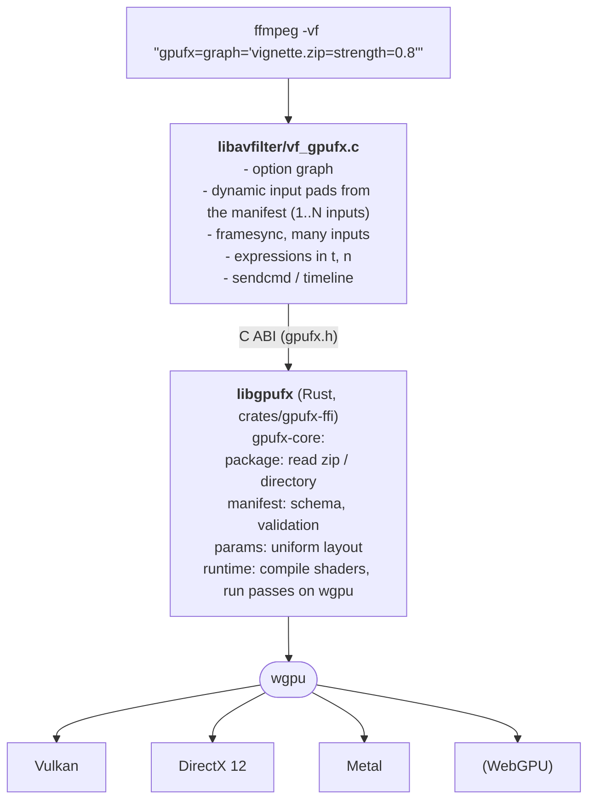
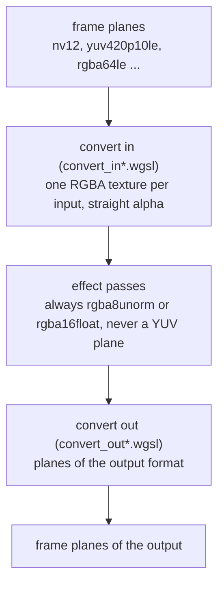

Tiếng Việt: [DESIGN-vi.md](DESIGN-vi.md)

# Design: FFmpegGpuFilter (gpufx)

> Goal: run video effects as **GPU shaders** inside FFmpeg's `filter_graph`, with effects
> **loaded from external `.zip` packages** (CapCut style). Adding a new effect does not
> require rebuilding FFmpeg: you just supply the zip package and its parameters, and wire up the inputs/outputs in the graph.

## 1. Requirements

| # | Requirement | How it is met |
|---|-------------|---------------|
| R1 | **Shaders come first** (the reason to use a GPU) | Each effect *is* a chain of compute shaders. WGSL and GLSL are supported from the first version, with shader error checking that reports line numbers, multiple passes, bundled textures, and parameters generated automatically as `uniform`s |
| R2 | Multiple operating systems | Windows, Linux, macOS (Android/iOS later) |
| R3 | Multiple hardware / APIs | Vulkan, DirectX 12, Metal through **wgpu**; CUDA/D3D11/VAAPI through interop (phase 2). OpenGL was dropped: it cannot share FFmpeg frames and has no R8/R16 storage textures for YUV planes |
| R4 | Effects loaded externally, no FFmpeg rebuild | A single `gpufx` filter built **once**; effects are zip packages |
| R5 | Use Rust or C/C++ | The engine is written in **Rust**; the glue into FFmpeg is one small C file |

## 2. Architecture overview



**Why only one filter?** FFmpeg has no run-time filter plugin mechanism: every filter must be
compiled into `libavfilter`. So we add *one* generic `gpufx` filter (patched in once,
see `ffmpeg/integrate.sh`), and all the effect logic lives in the shaders of the zip package. This
is exactly the CapCut model: the app is fixed, and effects are downloaded data.

**Why Rust + wgpu?**
- wgpu is a mature GPU abstraction layer that runs Vulkan/DX12/Metal/GL from the same source.
- It comes with **naga**, a pure-Rust shader compiler that reads WGSL, GLSL and SPIR-V and translates to
  SPIR-V/HLSL/MSL/GLSL for each backend. This is the most important part for R1: the author writes a
  shader **once** and it runs on every API.
- Rust is memory-safe when reading untrusted zip packages, and it exports a stable C ABI for FFmpeg.

Alternatives considered and rejected:

| Alternative | Why it was not chosen as the core |
|-------------|-----------------------------------|
| Vulkan + SPIR-V directly (like `libplacebo`) | Does not run natively on macOS/DX; we would have to rewrite what wgpu already provides |
| Write separate CUDA/DX/Vulkan code for each effect | Violates R4: every effect × every API |
| OpenCL (`vf_program_opencl`) | Uneven driver quality, absent on recent macOS, not a graphics shader |
| Plug into `libplacebo` custom shaders | Vulkan only, mpv hook syntax, no support for multiple inputs |

## 3. Effect package (`.zip`)

```
vignette.zip
├── manifest.json        required
├── shaders/*.wgsl|*.comp|*.glsl
└── textures/*.png       optional (LUT, mask, overlay)
```

Details of the format and how to write shaders: [EFFECT_FORMAT.md](../EFFECT_FORMAT.md).

`manifest.json` summary:

```json
{
  "api": 1,
  "id": "io.github.tqk2811.gaussian-blur",
  "name": "Gaussian Blur",
  "used_for": ["gpufx"],
  "inputs": [{ "name": "src" }],
  "params": [{ "name": "radius", "type": "float", "default": 6, "min": 0, "max": 48 }],
  "groups": [
    {
      "passes": [
        { "shader": "shaders/blur_h.wgsl", "inputs": ["src"], "outputs": ["tmp"] },
        { "shader": "shaders/blur_v.wgsl", "inputs": ["tmp"], "outputs": ["out"] }
      ]
    }
  ]
}
```

- `inputs` determines the number of input pads on the filter (a transition uses 2 inputs, etc.). The last input may
  carry `repeat` (WGSL only, `{default, min, max <= 16}`): it expands into pads `<name>0..N-1`, N = the number of
  labels the graph node reads (`default` without labels); the prelude adds `gpufx_input_count/size/load`.
- Output size: by default the size of the first input; a shader can set it with the optional function
  `gpufx_output_size(out_index)` of the pass that writes the output (it reads only `params`, `gpufx_input_count()` and
  `gpufx_input_size(i)`). Computed once by a one-off GPU dispatch at configure, from the param values then; 0 or above the GPU's
  `max_texture_dimension_2d` is an error, and a later change of the size fails processing. Downstream graph nodes see the propagated size.
  How it works, for programmers:
  - **Finding the function**: a pass sizes its outputs when the naga module of its compiled shader has a function named exactly
    `gpufx_output_size` ([runtime.rs](../../crates/gpufx-core/src/runtime.rs#L1263)), not when the text contains the name (a comment does not count). Such a pass
    gets a second, one-thread pipeline calling it ([runtime.rs](../../crates/gpufx-core/src/runtime.rs#L540)).
  - **Params it reads**: `params_read` ([runtime.rs](../../crates/gpufx-core/src/runtime.rs#L1418)) walks the naga IR of the size entry point and of every function
    it calls (`Statement::Call`, nested blocks included, [runtime.rs](../../crates/gpufx-core/src/runtime.rs#L1456)), and records each `AccessIndex` on the `params`
    global (group 0, binding 1) as one field read. A field is a whole param: a `vec2`/`color` param counts as one. When the access
    cannot be resolved to a field (the block loaded whole, e.g. passed or copied as a struct, or a dynamic `Access`), every param
    counts as read: conservative, never misses one.
  - **When**: `Effect::output_sizes` ([runtime.rs](../../crates/gpufx-core/src/runtime.rs#L711)) computes the sizes once, by a dispatch + readback, and keeps them with
    the input sizes and the values of the params read ([runtime.rs](../../crates/gpufx-core/src/runtime.rs#L604)). It never dispatches on the noop device (it errors
    instead, [runtime.rs](../../crates/gpufx-core/src/runtime.rs#L748)); the C API, while the effect is still on the noop device, opens it once on its backend's device
    to size the outputs and reuses that graph when the effect moves there ([lib.rs](../../crates/gpufx-ffi/src/lib.rs#L562), [lib.rs](../../crates/gpufx-ffi/src/lib.rs#L396)). The FFmpeg
    filter sets its param expressions at `t=0`, `n=0` before asking ([vf_gpufx.c](../../ffmpeg/vf_gpufx.c#L2539)).
  - **Per frame**: no GPU work. The values of the params read are compared on the CPU with the kept ones; one differing fails with
    "parameter `w` sets the size of the output ... and must not change while the stream runs", even when the size would be the
    same. Other params change freely. Other input sizes compute the sizes again (then the graph's size check fails on a change).
- `params` are **generated automatically** by the runtime into a `params` struct in the shader, following the
  WGSL/std140 uniform alignment rules; the author just uses `params.radius`.
- `passes` run sequentially; the output of one pass is a readable texture in the next; the last pass is the
  final output.
- Effects have `groups`, alternative sets of passes with device `requires` (see
  [EFFECT_FORMAT.md](../EFFECT_FORMAT.md#pass-groups-and-device-requirements)). `Program::new` chooses the first group matching the
  device; on the noop device only `os` is checked and every OS-matching group the noop device can compile is compiled to check its
  shaders, so opening is two steps: the noop device at `gpufx_effect_open`, the real device later.

## 4. Shader model (the core)

Each pass is a **compute shader**. Before the author's code, the runtime inserts an auto-generated
*prelude* (like Shadertoy providing `iResolution`, `iTime`):

| Binding | Name in the shader | Meaning |
|---------|--------------------|---------|
| 0 | `globals.size`, `globals.time`, `globals.frame`, `globals.time_int`, `globals.time_frac`, `globals.pixel_aspect` | Output size (px), time (seconds, f32), frame number, exact time (whole seconds + fraction), pixel aspect ratio (SAR) |
| 1 | `params.<name>` | Parameters from the manifest |
| 2 | `out_tex` | Texture the result is written to (`rgba8unorm`, or `rgba16float` when a frame of the chain has more than 8 bits) |
| 3 | `smp` | Linear sampler, clamp, linear between mip levels |
| 4.. | input/texture/pass names | Textures to read (`texture_2d<f32>`; `texture_2d_array<f32>` for package textures with `layers`/`grid`) |

Package textures can be texture arrays (`layers`, or an atlas cut by `grid`), with mip chains made
on the CPU and premultiplied alpha, all once when the `Program` loads; image sizes are checked from the PNG
headers (4096 a side, 64 M texels per package, the device limits) before anything is decoded. An input with
`mipmaps` gets its mip chain on the GPU every frame, in its own texture (the input slot or the pooled
texture of the effect writing it; pooled textures with and without mips are kept apart), so nothing is
copied. An `expr` parameter is compiled into the shaders as `gpufx_expr_<name>`, generated from a parsed
tree; an effect whose expressions differ from the defaults builds its own pipelines when they change
(the `Program` keeps the default ones). See [EFFECT_FORMAT.md](../EFFECT_FORMAT.md).

Helper functions `gpufx_in_bounds(id)`, `gpufx_uv(id)`, `gpufx_write(id, color)` are included.

Why compute instead of fragment shaders: no render pass or vertex buffer is needed, multiple
passes are easy, reads and writes are unrestricted (separable blur, histogram, reduce), and it maps directly onto CUDA/Metal
compute when needed.

Shader languages:

| Language | Status | Notes |
|----------|--------|-------|
| WGSL | ✅ prototype | The standard WebGPU language, with the clearest errors |
| GLSL 450 (compute) | ✅ prototype | Convenient for porting existing shaders (GL Transitions, Shadertoy) |
| SPIR-V (precompiled) | Planned | Lets authors use HLSL/Slang → SPIR-V with external tools |
| HLSL / Slang | Planned | Compiled to SPIR-V/WGSL in `gpufx pack` |
| Shadertoy-style fragment shader (`mainImage`) | Planned | Wrapped into a compute shader automatically |

Shaders are checked before running: naga parses and validates them, and errors come back with the file name and
the position in the code (try `gpufx check <package>`). The FFmpeg filter prints that error through `av_log` and refuses to
initialize the graph instead of running incorrectly.

## 5. The `gpufx` FFmpeg filter

Full reference (syntax, options, runtime commands, examples): [design/filters/gpufx.md](filters/gpufx.md).
Other filters: [gpufx_upload / gpufx_download](filters/gpufx_transfer.md),
[gpufx_ai_framerate](filters/gpufx_ai_framerate.md), [gpufx_ai_upscale](filters/gpufx_ai_upscale.md).

Design rationale:

- **One option, `graph`.** An effect, a chain (`a.zip|b.zip`) and a whole labelled graph with several inputs and
  outputs are one string, parsed by one code path (a single effect is the linear graph of one node). The number of
  input and output pads comes from the graph, so FFmpeg's own `-filter_complex` wires the filter like any other.
- **One GPU submit per event.** All passes of all effects of the filter, with the intermediate textures taken from a
  pool, run in one submission; between effects no frame leaves the GPU and nothing is converted. Several `gpufx`
  filters in a row also keep the frame on the GPU (`out_format=rgba` skips the YUV conversions between them).
- **GPU frames out only**, like the `*_cuda` filters: the output is a hardware frame of the API of the device (Vulkan,
  D3D12, D3D11, VideoToolbox), so `hwdownload` / `gpufx_download` goes before CPU filters and encoders. Software inputs
  are uploaded by the filter itself, so a one-filter pipeline needs no `hwupload`. The device comes from the GPU inputs,
  else `-filter_hw_device`; its type picks the API. Adding an API is one entry in `hw_apis[]` plus its cases in the
  per-API switches of `vf_gpufx.c`.
- **Parameters are FFmpeg expressions**, written inline next to the package and evaluated per frame (`t`, `n`, `w`, `h`...),
  so keyframes and transitions need no external tool; `sendcmd` / `zmq` change them while the stream runs.
- **Switching an effect off allocates nothing.** Inline `enable=` / `bypass=` turn an effect into a copy of one of its
  inputs, so the plan, the pooled textures and the bindings stay as they are and toggling is free of allocation. The
  filter-level `enable=` can hand the input textures on without any GPU copy (`passthrough`), and `bypass=auto` serves
  transitions that should keep showing the clip they ended on.
- **Framesync for several inputs.** The first input decides the length, frame rate, SAR and (unless the effect's `gpufx_output_size` gives another) the size; other inputs repeat, drop or hold frames to follow it.
- **Strict checks at configuration**, with errors that name the effect, input and key, instead of silent conversion.

The frame path behind this is in [section 6](#6-frame-path-and-performance). What a shader receives (prelude, bindings,
dispatch, colour): [EFFECT_FORMAT.md](../EFFECT_FORMAT.md#shader-reference-what-a-shader-receives).

## 6. Frame path and performance

**Working now (P1 done):** frame planes in RAM → texture upload → built-in conversion pass → effect
passes → built-in conversion pass → copy back to RAM. libgpufx converts `rgba`, `rgba64le`, `nv12`,
`p010le`, `yuv420p`/`yuv422p`/`yuv444p` and their `10le` versions, `yuva420p`, `yuva444p` (and the
`yuvj` aliases) itself:

- Each plane is uploaded to an integer texture (`r8uint`, `rg8uint`, `r16uint`, `rg16uint`,
  `rgba16uint`: core WebGPU formats on every backend, unlike `r16unorm`, which needs a native-only
  feature). A compute pass applies the matrix (BT.601, BT.709, BT.2020 non-constant luminance) and range
  (limited/full) of the `AVFrame`, upsamples chroma bilinearly at its siting (left, centre, top-left, top,
  bottom-left, bottom; unspecified is left) and writes the RGBA texture the first effect reads. Straight
  8-bit RGBA skips the pass.
- On output a pass converts the RGBA result to the output format (chroma downsampled with a triangle
  filter, `[1 3 3 1]` centred, `[1 2 1]` co-sited) and packs each plane into a storage buffer, which is
  copied to one mappable buffer and read back.
- RGBA textures are `rgba16float` when a frame of the chain (an input or the output) has more than 8 bits,
  so 10-bit survives the chain; otherwise `rgba8unorm`. Package PNGs stay `rgba8unorm`.
- The filter: inputs accept these formats directly (FFmpeg converts other formats to
  one of them; the manifest has no `formats` field, shaders always see RGBA). Formats, matrices (FCC, SMPTE 240M,
  YCgCo...) and BT.2020 constant luminance that libgpufx does not handle are converted with `swscale` to
  `rgba` (or `rgba64le` above 8 bits) as before. The output is never converted by swscale: the filter outputs GPU frames
  only (see "Formats the GPU does not convert"). An output may be any of these formats
  (default: the format of its source input, see below), so a CPU encoder taking `yuv420p` needs `hwdownload` after `gpufx`
  but no `scale`. Such an output may be YUV without alpha, dropping the alpha the effect writes: to keep it, use
  `out_format=rgba` (or `yuva420p`).
- Unspecified chroma siting is centre for full range frames (JPEG/MJPEG) and left otherwise.
- Each package compiles its `rgba8unorm` pipelines when it loads and its `rgba16float` ones when the
  first frame above 8 bits comes (that frame waits for the compile; an error names the package).
- `GPUFX_API_VERSION` only grows by additions: the filter accepts a library whose version is at least
  the header's.
- A disabled filter (timeline) converts input 0 to the output format on the GPU without running effects.

All `gpufx` filters in the same process share one GPU device.

The device asks for wgpu's default limits, except the buffer sizes (`device_limits` in `crates/gpufx-core/src/runtime.rs`, used
where `runtime.rs` creates a device and by `vulkan.rs` for FFmpeg's shared `VkDevice`). This is deliberate: a package sees the
same limits (16 sampled and 4 storage textures per pass...) on every GPU, so it is portable. Raising them later means asking for
the adapter limits under a common cap and checking each pass against the device.

Loaded packages are shared too. Each package (keyed by absolute path and GPU device) is read and compiled
only once per process: a `Program` holds the manifest, pipelines, PNG textures and
samplers. Each filter keeps its own `Effect` with parameter values, uniform buffers and frame
textures. When no filter uses the package any more, the `Program` is freed and the next open reads the
file again. Editing a zip file while a filter still uses that package has no effect, even for a filter
that opens the package after the edit.

The main costs are upload/readback and color conversion on the CPU. The roadmap to remove them step by step:

| Phase | Change | Benefit |
|-------|--------|---------|
| P1 (done) | Convert YUV (NV12/P010/yuv420p...) ↔ RGBA on the GPU in the runtime; `rgba16float` textures when a frame is above 8 bits | Drops `swscale`, supports 10-bit/HDR |
| P2 (done, differently) | The `gpufx` filter outputs GPU frames only, so it does no readback itself. Reading back to RAM is `gpufx_download`'s job: it submits the copy without waiting and keeps a ring of staging buffers (option `latency`, 2 frames by default) | No blocking on the previous frame on the way to RAM |
| P3 (done) | **Zero-copy** with `AV_PIX_FMT_VULKAN`: the wgpu device is made from `AVVulkanDeviceContext` (`wgpu-hal` `device_from_raw`) and the `VkImage`s of `AVVkFrame` are read and written in place (see "Vulkan frames" below) | No trip through RAM when decoding/encoding with Vulkan |
| P4 (dropped) | **CUDA** interop (NVDEC/NVENC). Not done: it needs a second wgpu device next to FFmpeg's CUDA context (more VRAM and RAM), semaphores shared between two APIs, and one GPU copy each way, yet gives no extra compute: tensor cores are reachable from WGSL through Vulkan cooperative matrix. For NVENC, use `gpufx_download` (NVENC uploads the frame itself) | — |
| P5 (done, untested on hardware) | **D3D12** frames in place on FFmpeg's `ID3D12Device`; **D3D11** through shared NT handles into wgpu's DX12 (see "D3D12 and D3D11 frames" below) | Works with `hwupload` on d3d12va/d3d11va; decoder frames with one GPU copy |
| P6 (VideoToolbox done, untested on a Mac) | VideoToolbox (`CVPixelBuffer` → IOSurface → `MTLTexture`, see "VideoToolbox frames" below); VAAPI/DRM-PRIME (Linux) | Covers all the common hwaccels |

In every phase, **the package format and shaders do not change**: authors never need to know whether a frame comes from
the CPU or from CUDA.

### Built-in format conversion (frame format ↔ RGBA)

Effects never see the frame format. gpufx-core wraps every graph with two built-in compute stages, recorded in the same
GPU submission as the effect passes (`run` for CPU frames, [graph.rs](../../crates/gpufx-core/src/graph.rs#L680), and `run_gpu` for GPU frames,
[graph.rs](../../crates/gpufx-core/src/graph.rs#L847)):



1. **Convert in**: `InputSlot::encode` ([convert.rs](../../crates/gpufx-core/src/convert.rs#L604)) records one dispatch per
   input that turns the planes into the RGBA texture the first effect pass samples.
2. **Effects**: the pass textures are `rgba8unorm`, or `rgba16float` when the graph is "deep" (rule below). A
   shader author sees the same colour texture whatever the frame was.
3. **Convert out**: for each graph output, one dispatch per plane (buffer and image paths) or one dispatch for all
   planes (fused YUV path) writes the planes of the output format from the RGBA result.

A stage is skipped when it would only be a copy. A straight `rgba` CPU input is uploaded as `rgba8unorm` and read in
place (`InputKey::direct`, [convert.rs](../../crates/gpufx-core/src/convert.rs#L427), set at
[graph.rs](../../crates/gpufx-core/src/graph.rs#L535)). A straight `rgba` Vulkan input is read in place when the graph is not
deep and no mip chain of it is read ([graph.rs](../../crates/gpufx-core/src/graph.rs#L548)), and a straight `rgba` GPU output may
be written by the last effect pass itself (`direct_out`, described under "Vulkan frames").

What the conversion does **not** do: no transfer function (gamma/PQ/HLG) and no primaries change. Nothing in
`gpufx-core` handles them (the frame's `ColorInfo` carries only matrix, range, chroma location and premultiplied
flag), and the shaders only apply the matrix and the range. The numbers in the RGBA texture are the non-linear R'G'B'
that the matrix gives, whatever the transfer is. The C layer copies primaries and transfer to the RGBA side of a
swscale conversion so that swscale never maps them either (`set_rgba_props`,
[vf_gpufx.c](../../ffmpeg/vf_gpufx.c#L683)). An effect that needs linear light does the transfer itself.

#### Files

| File | Role |
|------|------|
| [convert.rs](../../crates/gpufx-core/src/convert.rs) | Rust side: `Converter` (pipelines per device, [L52](../../crates/gpufx-core/src/convert.rs#L52)), `InputSlot` (input stage, [L440](../../crates/gpufx-core/src/convert.rs#L440)), `GpuOutputSlot` (output of GPU frames, [L617](../../crates/gpufx-core/src/convert.rs#L617)), `OutputSlot` and `read_outputs` (output to a CPU readback, [L748](../../crates/gpufx-core/src/convert.rs#L748), [L875](../../crates/gpufx-core/src/convert.rs#L875)), `uniform` ([L370](../../crates/gpufx-core/src/convert.rs#L370)) |
| [convert.wgsl](../../crates/gpufx-core/src/convert.wgsl) | Prepended to every conversion shader: the `Conv` uniform struct ([L5](../../crates/gpufx-core/src/convert.wgsl#L5)) and the helpers `code_max`, `code_scale`, `kg` |
| [convert_in.wgsl](../../crates/gpufx-core/src/convert_in.wgsl) | `pixel(id)`: planes to straight RGBA of one pixel (range, chroma upsampling, matrix, alpha). No entry point |
| [convert_in_plain.wgsl](../../crates/gpufx-core/src/convert_in_plain.wgsl) | Entry point, 8x8 workgroup, chroma read straight from the planes (CPU uploads) |
| [convert_in_tiled.wgsl](../../crates/gpufx-core/src/convert_in_tiled.wgsl) | Entry point, 16x16 workgroup, chroma loaded once into workgroup memory (GPU frames) |
| [convert_out.wgsl](../../crates/gpufx-core/src/convert_out.wgsl) | Shared by every output path: `fetch` (clamp, premultiply), `yuv`, `sample` (chroma downsampling), `encode` (range, depth, shift), `channel`. No entry point |
| [convert_out_buffer.wgsl](../../crates/gpufx-core/src/convert_out_buffer.wgsl) | Entry point: one plane packed into `u32` words of a storage buffer (CPU readback) |
| [convert_out_image.wgsl](../../crates/gpufx-core/src/convert_out_image.wgsl) | Entry point: one plane into a unorm storage texture (GPU frames, RGBA formats) |
| [convert_out_fused.wgsl](../../crates/gpufx-core/src/convert_out_fused.wgsl) | Entry point: every plane of a YUV GPU frame in one dispatch |
| [frame.rs](../../crates/gpufx-core/src/frame.rs) | `PixelFormat` and `Layout` ([L11](../../crates/gpufx-core/src/frame.rs#L11), [L110](../../crates/gpufx-core/src/frame.rs#L110)): plane kind, depth, shift, subsampling, alpha; `Matrix`, `Range`, `ChromaLocation`, `ColorInfo` |

#### How the pipelines are built

All shader text is assembled in Rust and compiled per device by `Converter` (created with the context in
[runtime.rs](../../crates/gpufx-core/src/runtime.rs#L229)):

- `pipeline()` ([convert.rs](../../crates/gpufx-core/src/convert.rs#L92)) concatenates `convert.wgsl` and a body (`include_str!`),
  parses it with naga and calls `ShaderCache::compute_pipeline`. The full source text is part of the cache key
  (`&["convert", "main", &source]`), so the on-disk cache (see "On-disk shader cache") needs no extra invalidation when
  a `.wgsl` file changes. These pipelines are built with no package (`pkg = None`), so `gpufx pack --precompile`
  neither warms nor stores them: they are compiled (or read from the on-disk cache) when the context creates them, or
  on first use for the lazy ones.
- Input ([convert.rs](../../crates/gpufx-core/src/convert.rs#L120)): `convert_in_source(deep, unorm)` generates the four plane
  bindings `plane0..3` (bindings 2..5) and the functions `load0..3`, then appends `convert_in.wgsl`, then the plain or the
  tiled entry point. `unorm` picks the plane texture type: `texture_2d<u32>` for CPU uploads (the load returns the stored
  code) or `texture_2d<f32>` for GPU frames (`round(texel * 255 or 65535)` gives the code back). `deep` does a text
  replace of `rgba16float` by `rgba8unorm` in `convert_in.wgsl`, so that file may contain the word `rgba16float` only in its
  `dst` declaration. Four pipelines in total (CPU or GPU, 8-bit or deep). The CPU pair is built in `Converter::new`; the
  GPU pair on the first GPU frame (`OnceLock`).
- Output to a buffer ([convert.rs](../../crates/gpufx-core/src/convert.rs#L180)): `convert_out.wgsl` and
  `convert_out_buffer.wgsl`, one pipeline for all formats and planes; the per-plane differences are all in the uniform.
  It reads the RGBA with `textureLoad` on a non-filterable float texture, so `rgba8unorm` and `rgba16float` sources share it.
- Output to plane images ([convert.rs](../../crates/gpufx-core/src/convert.rs#L236)): `convert_out_image.wgsl` with the text
  `STORAGE_FORMAT` replaced by the WGSL storage format from `PLANE_FORMATS` ([L72](../../crates/gpufx-core/src/convert.rs#L72):
  `r8unorm`, `rg8unorm`, `rgba8unorm` and the three 16-bit ones). One lazy pipeline per plane texture format.
- Fused YUV output ([convert.rs](../../crates/gpufx-core/src/convert.rs#L269); `fused_source`,
  [L283](../../crates/gpufx-core/src/convert.rs#L283)): one lazy pipeline per `PixelFormat` (array sized by `PIXEL_FORMATS`,
  [L315](../../crates/gpufx-core/src/convert.rs#L315)). Rust generates the `dst0..` storage bindings of the format's planes and
  two functions the shader calls: `store_luma` (plane 0, plus plane 3 for the alpha of `yuva*`) and `store_chroma`
  (planes 1 and 2, or the two-channel plane 1 of semi-planar). Channels a plane texture has but the format does not
  use are written as 0, alpha 1.
- Bind groups are cached: an `InputSlot` keeps an LRU of the bind groups of the plane textures of recent GPU frames, and
  a `GpuOutputSlot` one of recent (source, planes) pairs, so a pool of frames coming back in turn is bound once.

The `Conv` uniform ([convert.rs](../../crates/gpufx-core/src/convert.rs#L370), 112 bytes) carries frame size, chroma size and
subsampling, plane kind, alpha flag, depth, shift, range, premultiplied flag, `kr`/`kb`, chroma siting and, for
outputs, the plane geometry and which channel (Y/R, U/G, V/B, A) each interleaved sample holds. The WGSL struct
([convert.wgsl](../../crates/gpufx-core/src/convert.wgsl#L5)) and the Rust word list must stay in the same order; a size change
also changes `UNIFORM_SIZE`.

#### Input path

Per pixel, `pixel()` in [convert_in.wgsl](../../crates/gpufx-core/src/convert_in.wgsl#L45):

1. Read the stored code(s). `value()` undoes the P010 shift (`raw >> shift`).
2. **RGBA formats** (`kind` 0): divide by `code_max()` (`rgba64le` is 16 bit).
3. **YUV formats**: luma is normalised by range (`luma`, [L12](../../crates/gpufx-core/src/convert_in.wgsl#L12): limited
   `(c - 16s) / 219s` with `s` = `code_scale()`, full `c / max`); chroma likewise (`chroma`,
   [L19](../../crates/gpufx-core/src/convert_in.wgsl#L19): `(c - 128s) / 224s`, or `(c - mid) / max`). Chroma is upsampled
   **bilinearly**: `chroma_pos` ([L37](../../crates/gpufx-core/src/convert_in.wgsl#L37)) gives the fractional chroma coordinate
   under the pixel centre from the siting (`ChromaLocation::siting`, [frame.rs](../../crates/gpufx-core/src/frame.rs#L209)), the
   four neighbours are mixed, and coordinates are clamped to the plane (`load_uv`,
   [L27](../../crates/gpufx-core/src/convert_in.wgsl#L27); semi-planar reads one `rg` texel, planar two textures). Then
   `R = Y + 2(1-kr)V`, `B = Y + 2(1-kb)U`, `G = (Y - kr R - kb B) / kg`, with `kr`/`kb` from the frame's `Matrix`
   (`kr_kb`, [frame.rs](../../crates/gpufx-core/src/frame.rs#L173)).
4. Alpha: `yuva*` read plane 3 (full size, divided by `code_max`); other formats give 1.
5. The colour is clamped to 0..1 (super-white, super-black and out-of-gamut values are lost here). If the frame is
   `premultiplied`, RGB is then divided by alpha (0 where alpha is 0), so effects always see straight alpha.

The two entry points differ in how chroma is fetched. `convert_in_plain` is one invocation per pixel, each with up to
four clamped loads of chroma. `convert_in_tiled` (GPU frames) has each 16x16 workgroup load the chroma samples it needs
once into `uv_tile` (at most 18x18 entries; `uv_width = 15 / sub_x + 3`), waits at a barrier, then calls the same
`pixel()`; the values are identical. `in_group()` ([convert.rs](../../crates/gpufx-core/src/convert.rs#L40)) sets the dispatch
size and must match the `workgroup_size` of the entry point in use.

CPU frames: `InputSlot::pool_keys` ([L461](../../crates/gpufx-core/src/convert.rs#L461)) lists the upload textures (one per
plane, integer format from `plane_format`, [L356](../../crates/gpufx-core/src/convert.rs#L356)) and the RGBA target; `upload`
([L568](../../crates/gpufx-core/src/convert.rs#L568)) writes the planes and the uniform. GPU frames: `use_gpu_frame`
([L586](../../crates/gpufx-core/src/convert.rs#L586)) binds the frame's own plane textures and uploads only the uniform.
Planes the format does not have are bound to a 1x1 dummy texture (`Converter::dummy`).

**Deep or not** (`work_format`, [convert.rs](../../crates/gpufx-core/src/convert.rs#L22)): a format with `depth > 8` wants
`rgba16float`. A graph is deep when any input or output frame wants it
([graph.rs](../../crates/gpufx-core/src/graph.rs#L543)); the pass textures of the whole graph and the conversion pipelines
follow. `rgba16float` keeps about 11 bits, so `rgba64le` in and out does not round-trip all 16 bits.

#### Output paths

`sample()` in [convert_out.wgsl](../../crates/gpufx-core/src/convert_out.wgsl#L22) gives the Y/U/V/A (or R/G/B/A) of one sample
of a plane, and `encode()` ([L51](../../crates/gpufx-core/src/convert_out.wgsl#L51)) turns a 0..1 value into the stored code
(range scaling, depth, rounding, clamp, `<< shift`). There are three ways to write it:

| Path | Used for | Granularity | Result |
|------|----------|-------------|--------|
| Buffer (`OutputSlot`, `convert_out_buffer.wgsl`) | CPU frames (`run`) | One dispatch per plane, one invocation per output `u32` word, which packs 4 or 2 samples through `channel()` | Words in a pooled storage buffer, copied into one mappable buffer shared by all outputs; `read_outputs` copies the rows into the caller's planes |
| Image (`GpuOutputSlot`, `convert_out_image.wgsl`) | GPU frames, RGBA formats (`rgba`, `rgba64le`) | One dispatch per plane, one invocation per sample | `textureStore` into the plane's unorm texture (code / 255 or / 65535) |
| Fused (`GpuOutputSlot`, `convert_out_fused.wgsl`) | GPU frames, any YUV format | One dispatch for all planes, one invocation per **chroma** sample (it also writes the `sub_x * sub_y` luma samples of its block, and alpha) | `store_luma` / `store_chroma` into the plane textures |

- **Chroma downsampling**: for a subsampled plane `sample()` applies a triangle filter over the pixels around the chroma
  sample (4x4 taps, weight `max(1-d, 0)` per axis, normalised), placed by the same siting. It is the transpose of the
  bilinear upsampling: `[1 3 3 1]` for centred siting, `[1 2 1]` for co-sited. `convert_out_fused.wgsl` computes the same
  sum in the same order, but converts the pixels of the workgroup to YUV once into `px` (20x20 for 4:2:0), so the
  bytes equal the buffer path's (CPU frames); `yuv_gpu_frames_match_cpu_frames_across_tiles`
  ([tests/gpu_frames.rs](../../crates/gpufx-core/tests/gpu_frames.rs#L508)) checks GPU frames against the CPU path byte
  for byte on every backend but Metal (fast math, one step). Luma is never filtered. Full-size chroma (4:4:4) is a plain `yuv()`.
- **Matrix and range**: `yuv()` ([L16](../../crates/gpufx-core/src/convert_out.wgsl#L16)) is the inverse of the input
  matrix with the `kr`/`kb` of the output frame's `ColorInfo`; `encode()` applies limited (219/224 scale plus offset) or
  full range per channel. Alpha is always full range.
- **Alpha**: `fetch()` ([L7](../../crates/gpufx-core/src/convert_out.wgsl#L7)) clamps to the frame and, if the output is
  `premultiplied`, multiplies RGB by alpha before the matrix (see `ColorInfo`). Formats with an alpha channel or plane
  (`rgba`, `rgba64le`, `yuva420p`, `yuva444p`) store alpha at full resolution, unfiltered; formats without one ignore it.
- **Depth**: `encode()` rounds to nearest and clamps. 10-bit planar formats store the code in the low bits, P010 shifts it
  to the high bits (`shift` = 6). Samples are 1 or 2 bytes (`bytes`); the buffer path packs them little-endian.
- **Size limit**: `OutputSlot::new` fails if a plane needs more than `max_storage_buffer_binding_size`
  ([convert.rs](../../crates/gpufx-core/src/convert.rs#L759)); the image paths write textures and have no such limit.

#### How the output format is chosen

The core does not choose; it builds the convert-out that matches the output frame it is given (`GpuOutputSlot::new` and
`OutputSlot::new` take the format of the frame). The choice is made by the C filter:

1. **Manifest**: no format list. The manifest has no `formats` field on `inputs` or `outputs` (giving it is an "unknown
   field" error); every output may be any format libgpufx converts. An effect that writes meaningful alpha needs
   `out_format=rgba` (or `yuva420p`) when its input format has no alpha.
2. **Filter option `out_format`**: one entry, or one per output pad separated by `|`; it may be any GPU-converted
   format (the old check "must be in the output formats" is gone). A format libgpufx does not convert fails configuration.
3. **Candidate order** (`config_vulkan_output`, [vf_gpufx.c](../../ffmpeg/vf_gpufx.c#L949); `config_d3d_output`,
   [L1224](../../ffmpeg/vf_gpufx.c#L1224)): `out_format` if set, else the `sw_format` of the input
   `source[k]` (`hw_in_fmt[source[k]]`) when libgpufx can write it, else `rgba`. `source[k]` comes from `gpufx_effect_output_source`
   ([vf_gpufx.c](../../ffmpeg/vf_gpufx.c#L587)): the first input, or the output's `bypass` input, found by following the
   graph from the output back through the first input of each effect. A candidate is skipped when
   libgpufx does not convert it or the API cannot write it. With `out_format` there is no fallback: that
   format or an error.
4. **API limits**: Vulkan needs FFmpeg to make one-image-per-plane images with storage usage for the format
   (`av_vkfmt_from_pixfmt`, `VK_IMAGE_USAGE_STORAGE_BIT`). D3D12 and D3D11 accept `nv12`, `p010le`, `rgba`, `rgba64le`;
   VideoToolbox `nv12`, `p010le` (`sw_format_ok`, [vf_gpufx.c](../../ffmpeg/vf_gpufx.c#L1101)).
5. The format goes into the output `AVHWFramesContext`. For each frame the filter passes libgpufx the format name and the
   `ColorInfo` built from the frame (`gpu_color_fmt`, [vf_gpufx_frames.h](../../ffmpeg/vf_gpufx_frames.h#L87)), and the core
   builds or reuses the slot for that (format, size).

So a `yuv420p10le` input comes out as `yuv420p10le`, and `out_format=rgba` always outputs `rgba`. Between effects of
a chain or graph the textures are RGBA.

**What is lost going from RGBA to a format without alpha** (for example `nv12`): the alpha the effect wrote is dropped.
It is not composited over a background, so a transparent pixel keeps whatever RGB the effect left under it (often
black). Besides alpha: chroma resolution (4:2:0 and 4:2:2 average the pixels around each sample), limited range keeps
219 / 224 levels, values are rounded to the depth of the format, and RGB outside the gamut of the matrix is clipped. If
the chain is 8-bit (`rgba8unorm`) and the format is 10-bit, the extra bits only add rounding steps of 8-bit values.

#### Formats the GPU does not convert (swscale)

The C layer lets only formats the GPU can read through, and uses swscale for the rest:

- `query_formats` ([vf_gpufx.c](../../ffmpeg/vf_gpufx.c#L2248)): an input offers only
  formats libgpufx converts (`gpufx_format_supported`), so FFmpeg's negotiation inserts a `scale` (swscale) in front for
  the others (`gray`, `rgb24`, `yuv411p`...). A format that still reaches an input without being converted fails with
  ``pixel format `x` is not converted on the GPU (supported: ...)``.
- Software frames are uploaded by `upload_input` ([L1619](../../ffmpeg/vf_gpufx.c#L1619)) into GPU frames of the format
  chosen by `config_upload` ([L1574](../../ffmpeg/vf_gpufx.c#L1574)): the input's own format if the device takes it, else
  `nv12` / `p010le` for 4:2:0 YUV without alpha, else `rgba` / `rgba64le` (`rgba_for`,
  [L711](../../ffmpeg/vf_gpufx.c#L711)). When a frame is not in the upload format, or its matrix is one the GPU lacks
  (`gpu_matrix`, [vf_gpufx_frames.h](../../ffmpeg/vf_gpufx_frames.h#L46): BT.601 family, BT.709 and BT.2020 non-constant are
  handled; FCC, SMPTE 240M, YCgCo and BT.2020 constant luminance are not), `sws_convert`
  ([L700](../../ffmpeg/vf_gpufx.c#L700)) converts it first: to the upload format, or to full-range RGBA when the matrix is
  the problem. swscale keeps premultiplied alpha as it is; the GPU un-premultiplies afterwards.
- GPU frames (Vulkan, D3D, VideoToolbox) are never converted by swscale: an unsupported `sw_format` or matrix is a
  configuration or frame error that tells the user to convert before uploading.
- The output has no swscale fallback: it is always a GPU frame in a format libgpufx writes (header comment of
  [vf_gpufx.c](../../ffmpeg/vf_gpufx.c#L10): put `hwdownload` or `gpufx_download` before CPU filters and encoders).

#### Adding a pixel format

1. [frame.rs](../../crates/gpufx-core/src/frame.rs): add the `PixelFormat` variant, its `NAMES` entry, raise both literal
   `12`s (`NAMES`, `ALL`) and add a `layout()` row (kind, depth, shift, subsampling, alpha). Put the variant **last**
   and change `PIXEL_FORMATS` in [convert.rs](../../crates/gpufx-core/src/convert.rs#L315) (`Yuva444p as usize + 1`) to the new
   last variant. If the format is a combination of what exists (planar or semi-planar YUV or RGBA, depth up to 16,
   subsampling 1 or 2, an optional alpha plane), `plane_dims`, `plane_texture_format`, `plane_format`, `uniform` and the
   shaders need no change; `from_name` and `gpufx_format_supported` follow `NAMES`.
2. A new **layout** (packed YUV such as `yuyv422`, 3-channel RGB, subsampling 4) needs a new `PlaneKind` and edits in
   `plane_dims` / `plane_count`; `uniform` (channel map `ch`); the `kind` comment of `convert.wgsl`; `load_uv` and `pixel`
   of `convert_in.wgsl`; `sample` and `channel` of `convert_out.wgsl`; `fused_source`; and the tile sizes of
   `convert_in_tiled.wgsl` and `convert_out_fused.wgsl`, which assume subsampling of at most 2. Plane textures are
   limited to `PLANE_FORMATS` (1, 2 or 4 channels of 8 or 16 bits).
3. [vf_gpufx.c](../../ffmpeg/vf_gpufx.c): D3D and VideoToolbox accept a format only through `sw_format_ok` (add it there and
   to `sw_format_list`); Vulkan needs FFmpeg to give per-plane storage images for it. Check the candidates of
   `config_upload` if the format should be uploaded as itself. `gpufx_format_supported` lets it through already.
4. Tests: add the format to the lists in [tests/color.rs](../../crates/gpufx-core/tests/color.rs#L300) (CPU conversion) and
   [tests/gpu_frames.rs](../../crates/gpufx-core/tests/gpu_frames.rs#L281) (GPU frames against the CPU path). The format
   names are also listed in the text of section 6 above and in the `gpufx_format_name` comment of
   [gpufx.h](../../crates/gpufx-ffi/include/gpufx.h#L133).

### GPU graph inside one filter (done)

A single `gpufx` runs a whole effect graph, so complex branching stays on the GPU on every
backend (Vulkan, D3D12, Metal), without hardware frames:

```sh
ffmpeg -i a.mp4 -i b.mp4 -filter_complex "[0:v][1:v]gpufx=graph='[0]split[a][b]; [a]gaussian-blur.zip[ba]; [b]grayscale.zip|vignette.zip[gb]; [ba][gb]crossfade.zip[x]; [x][1]wipe-transition.zip[out]'[v]" -map "[v]" out.mp4
```

The single quotes protect `;` and `[]` from the outer filter graph. Rules:

- Statements are separated by `;`; each reads labels, runs a node and writes labels.
- `[0]`, `[1]`... are the filter's input pads (named `in0`, `in1`...). Every pad up to the highest must be read.
- Labels may be left out, as in an FFmpeg filtergraph, but on each side of a statement they are left out entirely
  or all given. Unlabelled inputs bind to the lowest input pads that no label names anywhere in the graph,
  later statements included (`[1]a.zip[x]; b.zip[y]` gives `b.zip` pad `[0]`). This differs from
  `ffmpeg -filter_complex`, which binds the first unused stream in order without looking ahead; gpufx looks
  ahead because a pad may be read only once. Unlabelled outputs become graph outputs named `out0`, `out1`...,
  skipping labels the graph already uses; an unlabelled `split` writes two.
- Only a description of one fully unlabelled statement whose node is a package chain (not `split`/`null`)
  behaves as the old chain: pads named after the first manifest's inputs, output `default`. Adding any label
  switches to pad names `in0`, `in1`... and output `out0`. A lone `null` is a valid no-op graph.
- Any other label (letters, digits, `_`, `-`; no `.`, which would clash with `label.param`) is written once and read at most once (`split` it to read it twice).
- **Outputs**: the labels no statement reads are the filter's output pads, in the order they are written
  (several are allowed; the pad names are the labels). There is no explicit output list: a misspelled
  label shows up as an extra output pad, which FFmpeg reports as unconnected.
- A node is `split` (one label in, any number out), `null` (one in, one out), or packages chained with
  `|` as in `graph=`, which take as many labels as the first package has inputs. An effect may have several
  outputs (manifest `outputs` array): labels after it name them by position or as `[name=label]`, the first
  unlabelled one goes on along the chain, a last effect without labels writes all of them, other unlabelled
  outputs are dropped with the passes only they need. In the engine an edge is `Source::Node(effect, output)`;
  each output has its own texture, size, bypass input and in-place frame.
  `split` and `null` cost nothing: their outputs *are* their input (two edges reading one texture).
- An effect writes the size of its first input (or the size from `gpufx_output_size`, propagated to
  downstream nodes); output pad k takes the SAR and frame rate of the
  input pad its source comes from. Frames come at input 0's events (framesync as with several inputs).
- Each input pad is uploaded once, each output pad is read back once, all outputs through one shared
  readback buffer; the whole graph runs in one submission, effects in topological order. The output
  frames of one event are sent together.
- `graph='a.zip|b.zip'` is the linear graph: `EffectGraph::parse` builds it, and a single
  effect runs through the same code. `graph` is the only filter option.
- Parameters are written inline after each package of a node (`[b]grayscale.zip|vignette.zip=strength=0.6[gb]`, see
  "Inline parameters" in [design/filters/gpufx.md](filters/gpufx.md)), so a graph example with values reads
  `graph='[0]split[a][b]; [a]gaussian-blur.zip=radius=8[ba]; [b]grayscale.zip|vignette.zip=strength=0.6[gb]; [ba][gb]crossfade.zip=progress=clip((t-1)/1.5\,0\,1)&enable=between(t\,1\,3)&bypass=auto[x]'`.
  `sendcmd` addresses values at run time as `node.name=value` over all packages of the graph in statement order
  (package label, 0-based index, bare name, or a node's output label: `ba.radius`, `gb.strength` finds the one
  effect of `grayscale|vignette` that has `strength`).
- Checked when the filter is created: cycles, labels read but never written, written twice or read twice,
  unread input pads, label counts against a node's inputs, numeric output labels. Checked at configuration:
  the manifest size and format rules of every node (an edge carries its producer's size and the format
  negotiated between the two effects), and input pads read by effects with no common format.
- With `enable=`, a disabled graph sends each output's source input pad (or the pad `bypass` picks)
  converted to the output format.
- Paths in a graph must not contain `[`, `]`, `;` or `|`.

C API (v5, additive): `gpufx_effect_open_graph` (the only open function), `gpufx_effect_output_count`, `gpufx_effect_output_name`,
`gpufx_effect_output_source`, `gpufx_effect_output_pad_format[_count]`, `gpufx_effect_process_graph`,
`gpufx_effect_convert_graph`, `gpufx_effect_output_size(fx, output, streams, count, &w, &h)` (the size of an output
for given input sizes; `vf_gpufx` `config_output` sets the outlink size from it); see `gpufx.h`.
Inline parameters: `gpufx_effect_open_graph` accepts them in every node, and `gpufx_effect_option_count` /
`gpufx_effect_option` read them back (constants are already applied; the caller evaluates expressions, `enable` and
`bypass`).

### Vulkan frames (done)

```sh
ffmpeg -init_hw_device vulkan=vk:0,disable_multiplane=1 -filter_hw_device vk -i a.mp4 \
  -vf "format=nv12,hwupload,gpufx=graph=vignette.zip,gpufx=graph=sepia.zip,hwdownload,format=nv12" out.mp4
```

- Every input pad also takes `AV_PIX_FMT_VULKAN`, and output pads take only GPU formats ([section 5](#5-the-gpufx-ffmpeg-filter)).
  Inputs may mix Vulkan and software frames (the filter uploads the software ones on the same device).
  The sw_format of each Vulkan input must be one libgpufx converts (`nv12`, `p010le`, `yuv420p`, `rgba`...) and
  is checked against the manifest rules like a software format. The filter is `FF_FILTER_FLAG_HWFRAME_AWARE`.
- **One device.** `init` opens the packages on wgpu's noop device (pads and formats are known before
  negotiation, and no GPU device is made yet); the filter never makes a device of its own
  (`gpufx_effect_use_default_device` stays in the C API for other callers); when the links are configured, `gpufx_effect_use_vulkan` moves the effect to FFmpeg's device: libgpufx
  wraps the `AVVulkanDeviceContext` handles with `wgpu-hal` (`Instance::from_raw`, `expose_adapter`,
  `Adapter::device_from_raw`, then `create_device_from_hal`), compiles the packages again for that device
  (shared per `VkDevice` like any device) and copies the parameter values. Nothing of FFmpeg's is destroyed
  with it (no-op drop callbacks); the filter holds a reference to the device until the effect is freed.
- **wgpu only uses what the device has enabled.** wgpu-hal picks features (and drops its own bounds checks
  when `robustBufferAccess` is supported) from what the *physical device* supports, but FFmpeg enables only
  some of it. wgpu therefore sees the device through a wrapped `vkGetInstanceProcAddr`:
  `vkEnumerateDeviceExtensionProperties` lists only the extensions enabled on the device,
  `vkGetPhysicalDeviceFeatures[2]` ANDs the core features with the enabled ones and every extension
  feature struct with the same struct of FFmpeg's creation chain (promoted structs, such as timeline
  semaphores, take their fields from FFmpeg's `VkPhysicalDeviceVulkan11/12/13Features`). Queues created with flags
  (`VK_KHR_internally_synchronized_queues`) are fetched with `vkGetDeviceQueue2`.
- **Queue.** The first queue family with graphics and compute, queue 0 (wgpu records render passes and graphics
  barriers: on the compute-only family that NVIDIA lists first the device is lost; libgpufx refuses such a family). The filter holds FFmpeg's `lock_queue` around
  each call, so FFmpeg's own submissions (hwupload, other Vulkan filters) never race with wgpu's.
- **Frames.** One `VkImage` per plane, in FFmpeg's per-plane formats (`R8`, `R8G8`, `R8G8B8A8`, `R16`,
  `R16G16`, `R16G16B16A16` `_UNORM`): inputs need `disable_multiplane=1` on the device (or frames made that
  way); the output frames contexts gpufx makes use `AV_VK_FRAME_FLAG_DISABLE_MULTIPLANE` and need
  `STORAGE` usage. A multiplane image is refused at configuration with a message saying so, and so are input frames without
  `SAMPLED` usage. FFmpeg 9.0 makes `yuva420p`/`yuva444p` frames contexts without any usage by default (the
  ones `hwupload` makes work), so outputs fall back to another format, e.g. `rgba`. The output
  sw_format is the source input's when libgpufx can write it and FFmpeg can make storage images of it, else
  `rgba`. `out_format` replaces that choice
  (that format or a configuration error). Chains of separate filters keep RGBA in between with
  `out_format=rgba` on all but the last (numbers in [BENCHMARK.md](../BENCHMARK.md): faster than without it, still
  slower than one `graph=`).
- **Per frame**, no CPU wait: the filter locks each `AVVkFrame` once (`lock_frame`; a frame split upstream
  may sit on two pads), libgpufx wraps every image as a wgpu texture (`texture_from_raw`, external memory,
  no-op drop callback) or reuses the wrapper made on an earlier frame (an LRU of 16 frames per pad, keyed
  by image, semaphore, format and size; the bind groups made from them are cached the same way, so a
  pool of frames coming back in turn is bound once). wgpu sees every wrapper in `GENERAL` between calls;
  an image left in another layout (by `hwupload`, `hwdownload`, another filter) gets a raw barrier to
  `GENERAL` in a command buffer submitted first (from `UNDEFINED` for outputs). The filter holds the
  frames contexts of its inputs and outputs until the effect is freed, so no image is freed before its
  wrapper. It then records the input conversion (planes read as
  unorm textures), the effects and the output conversion (planes written as storage textures), moves every
  image to `GENERAL`, and submits once with a wait on every image's timeline semaphore at `sem_value` and a
  signal at `sem_value + 1` (`add_wait_semaphore`/`add_signal_semaphore`, each semaphore once). The filter
  then stores `layout`, `sem_value` and `access` in the `AVVkFrame`s and unlocks them.
- **VRAM:** no upload textures, no output storage buffers, no readback buffer; the pooled pass textures are
  the same as for software frames; each input keeps one converted RGBA texture (as for uploads), and the
  outputs are FFmpeg's pool frames themselves. A straight `rgba` input of a graph that is not deep, and
  whose mip chain no effect reads, has neither: the effects sample its image in place (no copy-in pass),
  and the effects reading it are bound to the new image every frame. Likewise a straight `rgba` output
  (`out_format=rgba`) of such a graph is written by the last pass of the effect making it, with no pooled
  texture and no copy-out pass, when nothing else reads that effect's output (no other effect or graph
  output, no mip chain, no other pass of the effect). Anything else, and bypassed frames, keep the copies.
- **Conversion passes of GPU frames** (Vulkan and D3D12): the input pass of a YUV frame converts 16x16
  pixels per workgroup, from the chroma samples they read loaded once into workgroup memory (not four
  clamped loads per pixel). A YUV output is written by one pass for all its planes: each invocation writes
  one chroma sample and the luma (and alpha) samples of its block, from a tile of pixels converted to YUV
  once, with the weights of the chroma filter computed per row and column. The RGBA plane pass picks
  channels with `select`, not a vector index known only when running (which NVIDIA moves to local memory).
  The bytes are the same as before (tests compare with the CPU path). Measured with one vignette on 1080p
  wgpu textures (RTX 4060 Laptop, 3000 frames): nv12 copy-in 0.108 → 0.087 ms, copy-out 0.130 → 0.105 ms;
  rgba copy-out 0.087 → 0.049 ms. The conversion is not fused into the effects' first and last passes:
  effects sample their inputs through a linear sampler (filtering the YUV planes does not give the RGB
  the copy gives) and every effect pass would need a pipeline per frame format.
- **Profiling:** `GPUFX_PROFILE=1` asks the device for timestamp queries and prints, when each graph is
  freed, its GPU time per frame for copy-in, effects and copy-out, and its CPU time per frame (prepare, bind,
  record, import, submit). It splits the frame into three compute passes and waits for frames four behind,
  so wall time is not representative while it is on.
- A disabled filter always converts the frame on the GPU into the output's frames context (no pass by
  reference: the output has its own frames context). An input that has not started shows a black frame
  uploaded once (opaque for formats with alpha); software inputs get one too, in their upload format.
- Rust: `GpuFrame` (plane textures of the effect's device) and `EffectGraph::encode_gpu`, which records a
  whole graph into the caller's command encoder without submitting (backend independent, the base of the
  D3D12 step); `GpuContext::from_vulkan` and `EffectGraph::process_vulkan` (`gpufx_core::vulkan`, Linux and
  Windows) add the Vulkan sharing and synchronisation. C API (v6, additive): `gpufx_vulkan_supported`,
  `gpufx_effect_use_vulkan`, `gpufx_effect_process_vulkan`; see `gpufx.h`.
- Build: `scripts/build-prebuilt.sh` configures libavfilter with `--enable-vulkan` when the prebuilt
  `libavutil` has Vulkan and the Khronos Vulkan-Headers are found (cloned, tag `v1.4.321`; FFmpeg wants a
  header newer than Ubuntu noble's), and keeps `hwupload`, `hwdownload`, `hwmap`. Otherwise gpufx is built
  without Vulkan frames and the tests skip them.
- **Decoders:** the Vulkan decoders (`-hwaccel vulkan`) output multiplane images, so their frames are refused
  for now (`hwdownload,hwupload` or a GPU copy into per-plane images is needed; backlog).
- **Submissions** of one shared device are serialised by a mutex in libgpufx held from staging the semaphores
  to `queue.submit` (besides FFmpeg's `lock_queue`), inside a wgpu error scope; a submission wgpu refuses has
  its semaphores taken back and makes later Vulkan frames on that device fail cleanly.
- Tested on lavapipe: the bundle test compares the framemd5 of `hwupload,gpufx,...,hwdownload` with
  software frames that gpufx uploads itself (rgba, nv12, yuv420p, yuv444p, p010le, yuv420p10le, rgba64le, a graph whose two inputs are one split
  frame, two filters in a row, a changed output format); they are identical. Rust tests check
  `encode_gpu` against the CPU path byte for byte.

### Transfer filters `gpufx_upload` / `gpufx_download` (Vulkan)

Usage and options: [design/filters/gpufx_transfer.md](filters/gpufx_transfer.md).

Drop-in replacements for `hwupload` / `hwdownload` on Vulkan devices (`ffmpeg/vf_gpufx_transfer.c`, plain C
on FFmpeg's internal Vulkan helpers `libavutil/vulkan.h`, no libgpufx). Why: on NVIDIA FFmpeg 9.0 copies
through a staging buffer (host image copy and host memory import are off), and `hwdownload` waits on the CPU
for every copy (`ff_vk_exec_wait`), so CPU and GPU take turns. On the Intel Windows driver FFmpeg 9's host
image copies are broken; the frames contexts gpufx creates drop the host-transfer usage, and `gpufx` refuses
`hwupload` frames there ([INTEL_VULKAN.md](../INTEL_VULKAN.md)).

- **gpufx_upload** (`depth`, default 3): the frames context is made on `-filter_hw_device` like `hwupload`
  (input formats: the device's sw formats whose planes map 1:1 to Vulkan planes). A ring of `depth`
  persistently mapped, host-coherent staging buffers, one per execution context: memcpy into the slot,
  barrier + `vkCmdCopyBufferToImage` per plane, submit without waiting. The CPU waits only when it comes
  back to a slot whose copy is still running (`ff_vk_exec_start` waits for that slot's fence).
- **gpufx_download** (`latency`, default 2): `activate` filter. Frame k is submitted
  (`vkCmdCopyImageToBuffer` into slot k mod (latency+1), host-cached memory), frame k-latency is waited
  for (normally done), invalidated, copied into a buffer from `ff_get_video_buffer` and sent with its
  props. On EOF the frames in flight are flushed, then the status is passed on. The output format must be
  the frames' sw_format (add `format=<sw_format>` after it, like `hwdownload`).
  With sparse input (live sources) each frame comes out only `latency` frames later; `latency=0` turns
  the pipelining off. Neither filter takes a frame size change mid-stream (`hwupload`/`hwdownload` do):
  the graph stops with EINVAL.
- **Sync**: `ff_vk_exec_add_dep_frame` (lock_frame, wait on each image's timeline semaphore at
  `sem_value`, signal `sem_value + 1`), `ff_vk_frame_barrier` with no queue family transfer, and
  `ff_vk_exec_submit` (which takes FFmpeg's `lock_queue`), on FFmpeg's graphics queue family, the one
  `gpufx` and wgpu use. So they mix with `hwupload`, `hwdownload`, `gpufx` and the `*_vulkan` filters.
  The execution holds a reference to the frame until its copy has been read back.
- **Planes**: multiplane images (`PLANE_n` aspects) and one image per plane (`disable_multiplane=1`) both
  work. Each plane has its own region in the staging buffer: rows aligned to
  `optimalBufferCopyRowPitchAlignment` (and a multiple of the texel size, as `bufferRowLength` is in texels),
  plane offsets to `optimalBufferCopyOffsetAlignment` (at least 16). The copied size is the link's size
  (decoder frames contexts may be larger).
- **Queues**: `ff_vk_exec_pool_init` asks for its queues with the flags libavfilter was compiled for; the
  prebuilt libavutil creates them with `VK_KHR_internally_synchronized_queues`, unknown to the Vulkan headers
  of the build, and `vkGetDeviceQueue2` then returns no queue. The filters fetch the queues again with the
  device's `queue_flags` (the validation layer still reports the pool's first call once, VUID-06225).
- Build: `integrate.sh` adds `vf_gpufx_transfer.o vulkan.o` (libavfilter's copy of `libavutil/vulkan.c`)
  and `gpufx_upload/download_filter_deps="vulkan"`; `docker/keep-filters.txt` (`FFMPEG_FILTERS=keep`) keeps both.
- Tests (`scripts/test-bundle.sh`): nv12, yuv420p and rgba round trips are bit-exact, multiplane and
  `disable_multiplane=1`, mixed with `hwupload` / `hwdownload`; `gpufx` between them equals the software
  path; every frame comes out with `latency=4`. Also checked by hand: p010, the Vulkan validation layer
  (no VUID from the copies; plain `hwupload`/`hwdownload` give VUID-00174/00191 there).

Measured on the 90 s clips (RTX 4060 Laptop, idle GPU): see [BENCHMARK.md](../BENCHMARK.md).

### D3D12 and D3D11 frames (built and cross-compiled, run only by the Windows CI job)

```sh
ffmpeg -init_hw_device d3d12va=dx -filter_hw_device dx -i a.mp4 \
  -vf "format=nv12,hwupload,gpufx=graph=vignette.zip,hwdownload,format=nv12" out.mp4
ffmpeg -init_hw_device d3d11va=dx -filter_hw_device dx -i a.mp4 \
  -vf "format=nv12,hwupload,gpufx=graph=vignette.zip,hwdownload,format=nv12" out.mp4
```

- Pads also take `AV_PIX_FMT_D3D12` and `AV_PIX_FMT_D3D11` (when libavfilter is built with d3d12va/d3d11va and
  libgpufx is a Windows build). Same rule as Vulkan: all inputs and outputs are frames of one API, or none.
  sw_formats: `nv12` and `p010le` in practice (the only ones FFmpeg's d3d12va makes, and the only ones of
  d3d11va that gpufx reads); libgpufx also takes RGBA8/RGBA16 resources (`rgba`, `rgba64le`) from other callers.
  Others are refused at configuration (d3d11va's BGRA would need a swizzle: backlog). Textures with more than
  one mip level are refused.
- **No alpha.** None of these sw_formats has alpha, so an effect output with alpha loses it at `hwdownload`,
  and an alpha `out_format` fails when FFmpeg makes the frames. The `alpha-extract` package carries the alpha as
  a gray `nv12` picture through a graph output instead; `alphamerge` joins it back on the CPU.
- **D3D12, one device.** wgpu-hal 30 has no `device_from_raw` for DX12, but D3D12 devices are singletons per
  adapter and process: libgpufx opens the wgpu DX12 adapter whose LUID is the device's
  (`ID3D12Device::GetAdapterLuid`) and checks that wgpu got the very same `ID3D12Device` (COM identity);
  otherwise (another D3D12 runtime such as an Agility SDK, an adapter wgpu filters out like the headless
  "Microsoft Basic Render Driver" duplicate of WARP) it refuses with a message. wgpu has its own command
  queue on that device.
- **D3D12 frames in place.** `AVD3D12VAFrame.texture` is wrapped once per plane (`texture_from_raw` +
  `with_plane_slice`: R8/RG8 or R16/RG16 views of the NV12/P010 resource). Frames rest in
  `D3D12_RESOURCE_STATE_COMMON` (FFmpeg's convention); libgpufx records the transitions to the state of each
  use and back itself, per subresource of the frame's slice, in command lists of its own before and after
  wgpu's, and creates the wrappers in that state, so wgpu records no barrier (it would transition the whole
  resource once per plane wrapper). One submission waits for each frame's `sync_ctx.fence` at `fence_value`
  and signals `fence_value + 1` (each fence once); the filter stores the value. FFmpeg's D3D12 upload does not
  wait for a frame's fence before writing it, so a call first waits on the CPU for the previous call's
  submission (one event in flight).
- **One GPU copy when in place is impossible**, into a texture libgpufx keeps per pad and plane (VRAM: one
  frame per such pad): an input that is a slice of a texture array (`AV_D3D12VA_FRAME_FLAG_TEXTURE_ARRAY`,
  decoders) or larger than the frame or denied to shaders, and an output without
  `D3D12_RESOURCE_FLAG_ALLOW_UNORDERED_ACCESS`. The output frames contexts gpufx makes ask for unordered
  access first and fall back to frames written by a copy (verbose message); each candidate context is probed
  with one `av_hwframe_get_buffer`, since a device may accept the context but fail to create its textures.
- **D3D11.** wgpu has no D3D11 backend: the effect runs on wgpu's D3D12 device of the D3D11 device's adapter
  (LUID through `IDXGIDevice`). Textures with `D3D11_RESOURCE_MISC_SHARED_NTHANDLE` are opened there with
  `CreateSharedHandle`/`OpenSharedHandle` without a copy (kept open, up to 64, holding a reference to the
  texture). The output frames contexts gpufx makes are such textures (`SHARED | SHARED_NTHANDLE`, bind
  `SHADER_RESOURCE | UNORDERED_ACCESS`, without UAV if the device refuses it: then the D3D12 copy above), so
  outputs are not copied. Inputs from `hwupload` or decoders are not shareable and are copied once on the
  D3D11 immediate context (`CopySubresourceRegion`, also resolving array slices) into a shared texture
  libgpufx keeps per input pad (VRAM: one frame per input pad). D3D11On12 was not used: it wraps D3D12
  resources for D3D11, while the frames here are made by FFmpeg's D3D11 device; keyed mutexes would also work
  but need `SHARED_KEYEDMUTEX` textures and CPU-side acquire/release. Order: a D3D12 fence shared with the
  D3D11 device (`ID3D11Device5::OpenSharedFence`, D3D11.4): the immediate context signals `v` and is
  flushed, the D3D12 submission waits `v` and signals `v + 1`, the immediate context waits `v + 1`, so
  FFmpeg's later D3D11 work (`hwdownload`, encoders) waits on the GPU, no CPU wait. The filter holds
  `AVD3D11VADeviceContext.lock` during the call.
- Rust: `GpuContext::from_d3d12` / `from_d3d11`, `EffectGraph::process_d3d12` / `process_d3d11`
  (`gpufx_core::d3d12`, `cfg(windows)`, built on `encode_gpu`). C API (v7, additive): `gpufx_d3d12_supported`,
  `gpufx_effect_use_d3d12`, `gpufx_effect_process_d3d12`, `gpufx_effect_use_d3d11`,
  `gpufx_effect_process_d3d11`; on other systems they fail with a message.
- Build: `scripts/build-prebuilt.sh win64` adds `--enable-d3d11va --enable-d3d12va` when the prebuilt
  `libavutil` has them (it does), fetching `d3d12.h`, `d3d12sdklayers.h`, `d3d12video.h` of mingw-w64 v12.0.0
  when the installed mingw-w64 (Ubuntu noble: 11) has no `d3d12video.h`.
- Tests: `test-bundle.sh` runs nv12/p010le vignette, two filters in a row, a graph whose two inputs are one
  split frame, the timeline, a late second input and a mixed-input rejection for both APIs, on adapters 0-3,
  and skips when there is no device or wgpu cannot share it. The CI job `ffmpeg-windows` runs them on WARP;
  they have not been run on hardware. With `REQUIRE_D3D=1` (set in both win64 CI jobs) a skip fails the test (D3D12 is exempt when the FFmpeg has no d3d12va hwdevice, since FFmpeg's D3D frames are D3D11)
  and a build without D3D12/D3D11 frames (no d3d12va/d3d11va, header fetch or sha256 failure) fails the build;
  the test prints a line of the APIs tested and skipped.
- The blank frame of an input that has not started (all GPU APIs, Vulkan included) comes from a small frames
  context of the filter's own, made like the input's (device, sw_format, image flags), not from the input's
  pool, which may have a fixed size upstream.
- The shared DX12 instance ignores `VALIDATION`, `GPU_BASED_VALIDATION` and `DEBUG` from the environment: the
  device is FFmpeg's too.

### VideoToolbox frames (macOS, compiled but not yet run on a Mac)

```sh
ffmpeg -init_hw_device videotoolbox=vt -filter_hw_device vt -i a.mp4 \
  -vf "format=nv12,hwupload,gpufx=graph=vignette.zip,hwdownload,format=nv12" out.mp4
```

- Pads also take `AV_PIX_FMT_VIDEOTOOLBOX` (when libavfilter is built with videotoolbox and libgpufx is a
  macOS build). sw_formats: `nv12` (`420v`/`420f`) and `p010le` (`x420`/`xf20`); the pixel format of each
  `CVPixelBuffer` is checked against the frames context's. Others (BGRA...) are refused at configuration, and
  software inputs that are not 4:2:0 cannot be uploaded (backlog).
- **Device.** The frames are `IOSurface`s, which any Metal device opens: libgpufx runs on wgpu's Metal adapter
  (high performance first), one context per process, and FFmpeg's VideoToolbox device is only held.
- **In place.** `CVPixelBufferGetIOSurface`, then one Metal texture per plane with
  `newTextureWithDescriptor:iosurface:plane:` (R8 + RG8 or R16 + RG16, usage shader read/write, shared storage;
  only unified-memory GPUs are taken, since managed textures would need a sync blit wgpu does not record), wrapped with `wgpu_hal::metal::Device::texture_from_raw` and
  `create_texture_from_hal`. The texture retains the surface, so wrappers are cached per pad by `IOSurfaceID`
  (16 frames × 4) like the Vulkan images, and dropping one releases the surface. An IOSurface plane larger
  than the frame is used from its top left corner.
- **No fence.** FFmpeg's VideoToolbox frames have no GPU sync object (uploads and downloads lock them on the
  CPU), so a call waits (`device.poll`) until its submission is done before returning.
- **Writing p010le** needs R16/RG16 storage textures (`TEXTURE_FORMAT_16BIT_NORM` and the adapter's format
  features): Apple GPUs have them; on a GPU without them a p010le output fails with a message naming the
  formats (no fallback yet: backlog).
- Rust: `GpuContext::from_videotoolbox`, `EffectGraph::process_videotoolbox`
  (`gpufx_core::videotoolbox`, `cfg(target_vendor = "apple")`, built on `encode_gpu`). C API (v9, additive):
  `gpufx_videotoolbox_supported`, `gpufx_effect_use_videotoolbox`, `GpufxVtFrame`,
  `gpufx_effect_process_videotoolbox`; on other systems they fail with a message.
- Tests: `test-bundle.sh` runs, on macOS only, nv12/p010le vignette against the Vulkan run or the software
  frames, two filters in a row, a split-frame graph, a late software input and a BGRA rejection. The CI job
  `ffmpeg-macos` builds FFmpeg from the submodule with VideoToolbox and runs it with `REQUIRE_VT=1`: a skip
  fails unless FFmpeg cannot create the device or there is no Metal adapter.

### Frame interpolation `gpufx_ai_framerate` (RIFE, gpufx-nn packages)

Usage and options: [design/filters/gpufx_ai_framerate.md](filters/gpufx_ai_framerate.md).

The `gpufx_ai_framerate` filter (`ffmpeg/vf_gpufx_ai_framerate.c`) raises the frame rate with a neural network run
by libgpufx on the same GPU frames and devices as `gpufx` (Vulkan, D3D12, D3D11, VideoToolbox). The model is a
gpufx-nn package (`docs/NN_MODEL_FORMAT.md`) whose `io.json` has kind `frame_interp` (RIFE v4.6 converted from
ncnn by `gpufx-nnconv`); the layers run as WGSL compute shaders, compiled through the shader cache.

The filter maps every point of the output frame-rate grid to a time between two source frames and asks libgpufx
for the frame at that time. FFI (`gpufx.h`, opaque `GpufxAiInterp`):

- `gpufx_ai_interp_open(model)` / `gpufx_ai_interp_free`: checks the package path; the model loads later.
- `gpufx_ai_interp_use_vulkan` / `_d3d12` / `_d3d11` / `_videotoolbox`: load the model on the caller's device
  (once per device); `gpufx_ai_interp_device` names the device.
- `gpufx_ai_interp_process_vulkan` / `_d3d12` / `_d3d11` / `_videotoolbox`: take the next source frame and make
  `nb_outputs` frames between the previous source frame and it, at `times[k]` in (0, 1]; a time of 1 copies the
  source frame. The source frame is converted to RGBA once and stays on the GPU for the next call. Semaphores,
  layouts and fences behave as in `gpufx_effect_process_*`.
- `gpufx_ai_interp_set_scene(threshold)`: scene change threshold, an SSIM in 0..1 computed as the official RIFE
  `inference_video.py` does (both frames scaled to 32x32 bilinearly, `ssim_matlab` over RGB); a pair below it is a
  cut and each frame made is the nearer source frame (RIFE repeats frame 0; it also scales the zero-padded frame, here the
  unpadded one). `gpufx_ai_interp_reset` forgets the previous frame (a
  discontinuity).

### VRAM budget (rule for every phase)

VRAM is limited, so GPU memory is kept as low as possible and nothing is duplicated:

- No copies on the way in or out: YUV plane textures and the converted RGBA texture are reused frame to
  frame, and the first effect reads the converted texture directly.
- Intermediate textures (pass outputs, chain links, graph edges) come from a pool keyed by size and
  format: a 1-input 2-effect chain of one pass each allocates two pass outputs, a third effect reuses the
  first. Textures whose lifetimes do not overlap share memory (ping-pong); a texture goes back to the pool
  right after its last reader, counted over the whole graph in execution order. A pass output that is a
  graph output is kept until readback. The plan is computed before anything is allocated
  (`EffectGraph::memory_plan`), so a wide graph costs only the textures alive at the same time, not one per
  node. Example, the diamond `[0]split[a][b]; [a]gaussian-blur[ba]; [b]grayscale|vignette[gb];
  [ba][gb]crossfade[out]`: five pass outputs share **3** pooled textures (blur's two passes and the gray
  frame are alive together; vignette reuses blur's first pass, crossfade the gray frame), plus one upload
  texture (straight RGBA is read directly) and one readback buffer: 5 frame-sized allocations
  (1920x1080 `rgba8unorm`: 3 x 7.9 MiB pooled, 41.5 MB in all), against 8 with one texture per pass
  output and a copy for `split` (5 + 1 + upload + readback).
- `rgba16float` (twice the size of `rgba8unorm`) only where precision needs it (inputs or outputs above
  8 bits); an all-8-bit chain stays `rgba8unorm`.
- Staging and readback buffers are shared, not per effect: one readback buffer holds every output of a graph. Textures are freed when the frame size changes.
- Package textures (PNG) belong to the shared `Program` and are loaded once per device.

### On-disk shader cache (`GPUFX_SHADER_CACHE`)
- `GPUFX_SHADER_CACHE=<dir>` keeps compiled pipelines across processes; unset, nothing is written.
  The directory is created if missing; if it cannot be written, gpufx warns once and runs without cache.
- One file per pipeline (`<sha256>.gpucache`), the hash covering the final shader source (prelude
  included), language, entry point, output format (`rgba8unorm`/`rgba16float`), gpufx and wgpu
  versions, backend and adapter (name, vendor, device, driver, driver_info). No mtime checks.
- Vulkan: the device requests `Features::PIPELINE_CACHE` when the adapter has it, and each pass
  pipeline is created with a `wgpu::PipelineCache` seeded from its file (`fallback: true`, so data of
  another driver or wgpu version is dropped by wgpu's header check) and dropped right after; nothing
  stays in memory. Files are written through a temporary file + rename; unreadable or corrupt files are
  ignored and rewritten. `GPUFX_SHADER_CACHE_MAX_MB` (default 256) caps the directory, the least
  recently used files are removed first.
- Each file is the wgpu blob followed by its SHA-256, checked before the blob reaches wgpu (mismatch:
  ignored, recompiled, rewritten). The directory must be private to the user: on Unix a directory
  writable by other users is refused with a warning, since the files reach the driver. Stale temp
  files (over 1 h) and the size limit are handled once per device.
- The key also holds the exact naga, wgpu-core and wgpu-hal versions (read from `Cargo.lock` by
  `build.rs`). Effect passes and the built-in conversion pipelines both go through the cache.
- D3D12: wgpu 30 has no on-disk pipeline cache there. When `dxcompiler.dll` is on the DLL search path,
  gpufx writes the HLSL itself with naga (registers matching wgpu-hal's root signature, `dxil.rs`),
  compiles it to DXIL (`cs_6_0`), keeps it as `<sha256>.dxil` (key adds DXC version and shader model)
  and loads it back with `Features::PASSTHROUGH_SHADERS` (requested only on D3D12 when a cache is
  configured). A blob D3D12 refuses is recompiled; if freshly compiled DXIL is refused too (no
  `dxil.dll`...), the file is removed; once two distinct shaders are refused that way, that device stops
  using DXIL. Without DXC, the normal path.
- `gpufx pack --precompile <dir> <out.zip>` compiles every pass (8-bit and `rgba16float` outputs, default
  `expr` values) on a D3D12 device (WARP is enough) and stores `compiled/dx12/<sha256>.dxil` (checksum
  appended) in the package; the key has no adapter, driver or DXC version, so machines without DXC
  can use it. A `compiled/` folder in `<dir>` is never copied. At run time the blobs are used only with
  `GPUFX_TRUST_PRECOMPILED=1` (then even without `GPUFX_SHADER_CACHE`): packages are not signed yet and
  passthrough shaders are not checked by wgpu. The variable is read when a context is created and then
  trusts every package that context opens; the appended SHA-256 only proves integrity, not who built the
  package. Missing or refused blobs fall back to the normal path (a refused blob is logged once);
  `ShaderCacheStats::precompiled` counts the hits.
- Metal: no on-disk cache in wgpu 30; only driver caches apply.

## 7. Effect package security

A zip package is untrusted data (downloaded from an effect marketplace):
- Block path traversal (`..`, absolute paths), and limit the number of files and the total unpacked size.
- No native code in the package: only shaders, validated by naga before they reach the driver.
- wgpu checks buffer/texture accesses; an infinite loop in a shader can hang the GPU →
  later phase: dispatch time limits and package signing (`signature` in the manifest).

## 8. Repo layout

```
crates/gpufx-core   Rust engine: package, manifest, params, runtime (wgpu)
crates/gpufx-ffi    libgpufx (.so/.dll/.dylib + .a) and include/gpufx.h
crates/gpufx-cli    the `gpufx` command: info, check, pack, run (test effects without FFmpeg)
ffmpeg/             vf_gpufx.c and integrate.sh (adds the filter to the FFmpeg source tree)
external/FFmpeg     FFmpeg submodule, pinned to n9.0-2-g03d9533176 (release/9.0) = the prebuilt's commit
docker/, build.sh   build FFmpeg + gpufx with one command in Docker (linux64, win64)
packages/gpufx    38 effects (groups ffmpeg, slideshow, standalone): color adjustment, blur, sharpen, chroma key, overlay, transitions, hstack/vstack (variable input count, larger output)...
scripts/            build-prebuilt.sh (builds only libavfilter, swaps it into the prebuilt FFmpeg),
                    test-bundle.sh (runs the effects through the package's ffmpeg),
                    install-libgpufx.sh (builds + installs the .pc for pkg-config),
                    pack-packages.sh/.ps1 (only packages effects into zips)
```

## 9. Distribution builds

**Fast way (what CI uses):** `scripts/build-prebuilt.sh [linux64|win64]` downloads the prebuilt FFmpeg
9.0 shared build (tqk2811/FFmpegBuild), builds `libgpufx` and **only `libavfilter`** from the
submodule with `--disable-everything` + every filter (`FFMPEG_FILTERS=all`, the default; `keep` limits it to
`docker/keep-filters.txt`) + gpufx, then swaps
`libavfilter.so.12` / `avfilter-12.dll` in the package. Conditions for sharing the same ABI:

- the same FFmpeg commit as the prebuilt (the submodule pins `03d9533176`, and the script checks it);
- the same major name (`libavfilter.so.12`, `avfilter-12.dll`); the script stops if the prebuilt
  has no file with that name;
- the ffmpeg CLI uses only the public API and looks up filters by name at run time, so removing filters does not
  break library loading. With `FFMPEG_FILTERS=keep` the list must include the filters the CLI inserts itself: `null`/`anull`,
  `format`/`aformat`, `scale`/`aresample`, `trim`/`atrim`, `apad`, `crop`, `hflip`, `vflip`,
  `transpose`, `rotate`.
- Linux: the RUNPATH of `libavfilter` is `$ORIGIN` (set with `patchelf`, because FFmpeg's configure
  turns `$$` into the PID), and every file in `bin/` gets its RPATH changed to `$ORIGIN/../lib`.
  Before swapping, the script compares the export table (`nm -D`) of the new `libavfilter` with the prebuilt's: if any
  symbol is missing, it stops.
- The rebuilt `libavfilter` (`--disable-autodetect`, LGPL by default) links only `avutil`, `swscale`,
  `swresample`, so `avcodec`/`avformat`/`avdevice` are not built. Filters that need them, external libraries
  (`drawtext`, `zscale`, `subtitles`...) or GPL (`boxblur`...) are still missing even with all filters on
  (win64: 440 filters instead of 62, `avfilter` dll 1.2 MB -> 6 MB, about one minute more build time).
  SIMD is enabled if `nasm` is available.
- win64: `avfilter-12.dll` uses `msvcrt.dll` while the prebuilt uses UCRT (see
  [Backlog-vi.md](../Backlog-vi.md) (Vietnamese)).
- win64: `bin/` holds `dxcompiler.dll` (DXC, downloaded from NuGet by
  `scripts/fetch-dxc.sh`, sha256 checked). wgpu finds it next to `ffmpeg.exe` to compile
  shaders for D3D12; without it wgpu falls back to the old FXC, which takes minutes on
  loop-heavy shaders (the falling leaves). `WGPU_DX12_COMPILER=fxc` forces FXC.

`scripts/test-bundle.sh dist/<target>` runs every effect, expression, `sendcmd`, timeline and
the cases that must report errors through the package's `ffmpeg`. CI runs it for linux64 (lavapipe) and for
win64 on a `windows-latest` runner.

**Full build:** `./build.sh [linux64|win64|all]` (or `build.ps1` on Windows) builds the Docker image, builds
`libgpufx` with Rust, copies the `external/FFmpeg` submodule to a temporary directory (the submodule is left
untouched), runs `integrate.sh`, then configures FFmpeg with:

- By default every filter is built (`FFMPEG_FILTERS=all`). With `FFMPEG_FILTERS=keep` it uses
  `--disable-filters`, then re-enables **all audio filters** plus the minimal list in
  `docker/keep-filters.txt` (`null`, `format`, `scale`, `trim`, `crop`, `hflip`, `vflip`,
  `transpose`, `rotate`, `sendcmd`, `split`, `gpufx`). The video filters that are kept are the infrastructure
  that the ffmpeg CLI inserts itself (trim for `-ss/-t`, rotation from metadata) or that gpufx needs (converting
  YUV ↔ RGBA). gpufx converts the common YUV formats on the GPU itself (P1); `scale` stays for the
  other formats.
- `libgpufx` is linked dynamically: on Linux `rpath=$ORIGIN` finds `libgpufx.so` next to `ffmpeg`,
  and on Windows `gpufx.dll` sits next to `ffmpeg.exe`. The DLL depends only on system DLLs
  (checked with `objdump`). The win64 bundle also gets `dxcompiler.dll` and its license texts in `bin/`
  (`scripts/fetch-dxc.sh`, as in the prebuilt flow).
- win64 is cross-compiled with mingw-w64 like BtbN/FFmpeg-Builds. There is no macOS bundle; the CI job `ffmpeg-macos` builds FFmpeg from source on
  a macOS runner only to test the VideoToolbox path.

## 10. Roadmap

1. **M0 – Prototype (this PR):** zip packages, WGSL + GLSL, multiple passes, multiple inputs, textures,
   parameters + expressions, FFmpeg 9.0 filter, CLI, 5 sample effects, automated tests. Since then:
   texture arrays, mipmaps (package textures and inputs), premultiplied textures, `expr`
   parameters compiled into the shaders; sprites/particles as stateless shaders (`falling-*`).
2. **M1 – Shaders:** SPIR-V/HLSL/Slang, a Shadertoy `mainImage` wrapper, `#include` of shared shader
   libraries (color, noise, blend modes), hot-reload during development, output size different from the input
   (crop/zoom/pad), optional samplers (nearest/repeat/mirror).
3. **M2 – Performance:** P1–P2 in section 6, benchmarks on NVIDIA/AMD/Intel/Apple.
4. **M3 – Zero-copy:** P3–P6.
5. **M4 – Ecosystem:** package signing, an effect store, preview/visual parameter tools,
   converters for some common effect formats (GL Transitions, `.cube` LUT).
